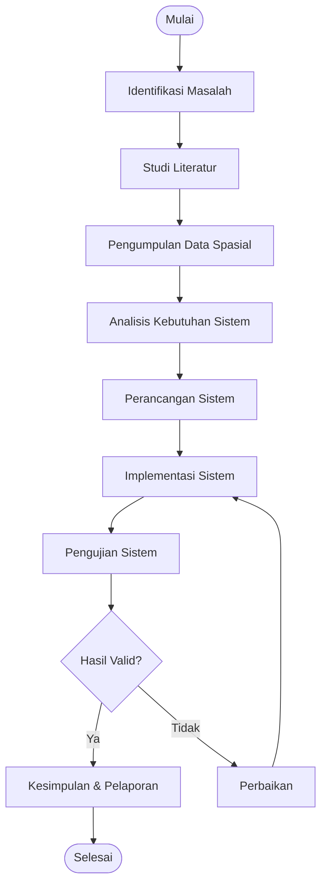
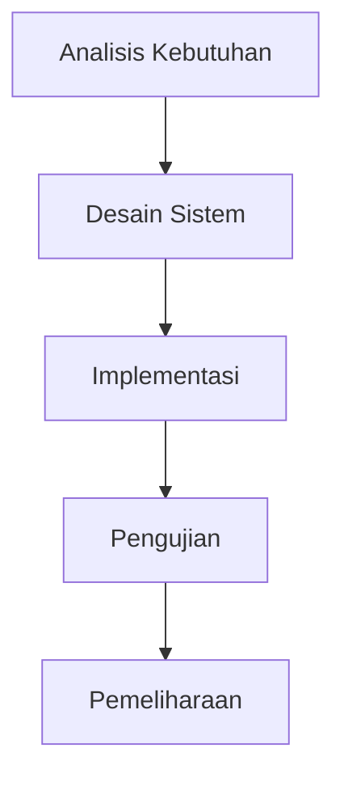
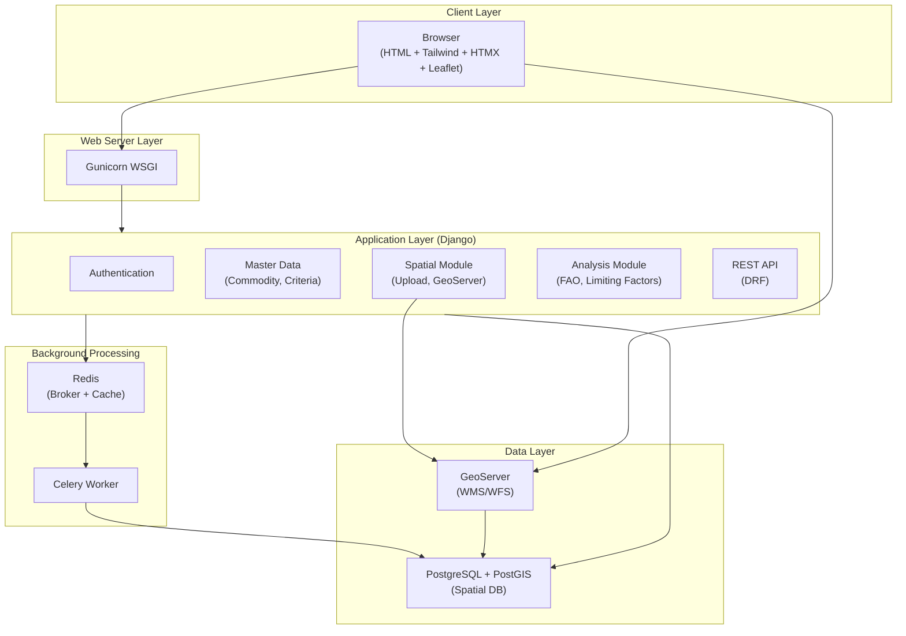
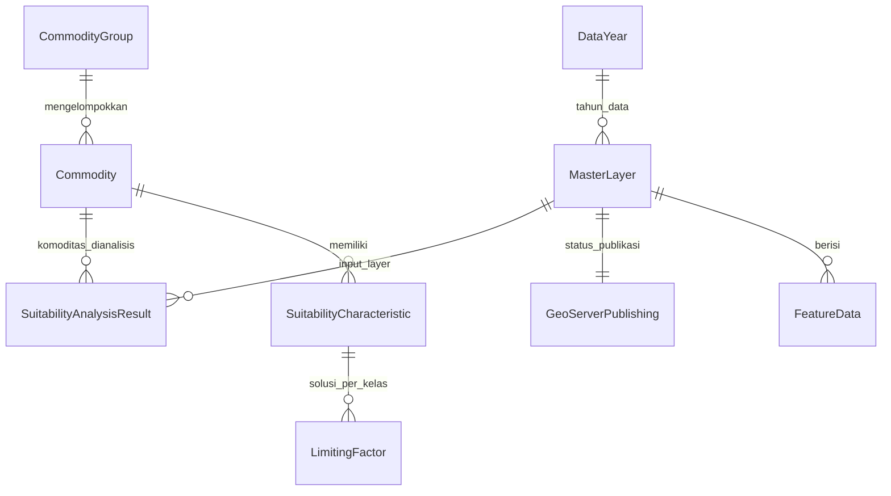
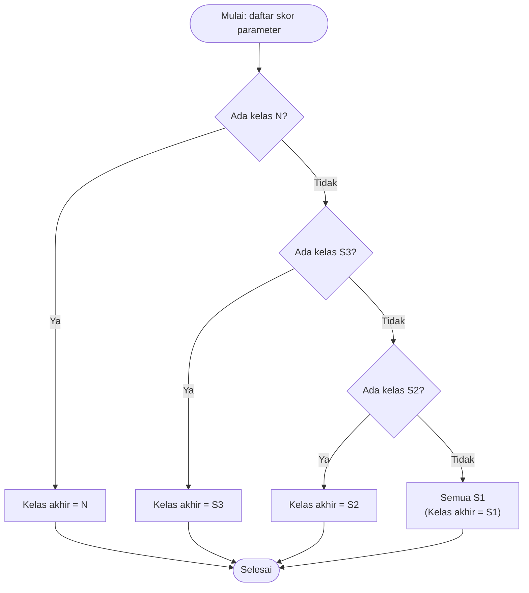

# BAB II
## METODE PENELITIAN

### 2.1 Waktu dan Lokasi Penelitian

Penelitian ini dilaksanakan dalam rentang waktu **November 2025 hingga Juli 2026**, bertempat di Laboratorium Komputasi serta dilakukan secara mandiri (*remote*) dengan dukungan infrastruktur *cloud* dan *local development environment*.

Lokasi studi yang menjadi objek analisis adalah **Kabupaten Barru, Provinsi Sulawesi Selatan**. Kabupaten Barru memiliki luas wilayah **1.174 km²** dan secara administratif terdiri dari **7 kecamatan**, yaitu: Tanete Rilau, Tanete Riaja, Barru, Soppeng Riaja, Mallusetasi, Pujananting, dan Balusu. Pemilihan Kabupaten Barru sebagai lokasi studi didasarkan pada ketersediaan data spasial yang lengkap dan representatif, mencakup parameter tanah, iklim, dan topografi yang dibutuhkan dalam analisis kesesuaian lahan.

### 2.2 Jenis Penelitian

Penelitian ini termasuk dalam kategori **penelitian eksperimental** (*experimental research*). Menurut Sugiyono (2019), penelitian eksperimental adalah metode penelitian yang digunakan untuk mencari pengaruh perlakuan (*treatment*) tertentu terhadap variabel lain dalam kondisi yang terkendali. Dalam konteks penelitian ini, perlakuan yang dimaksud adalah implementasi algoritma *FAO Minimum Method* pada data spasial unit lahan untuk mengukur akurasi dan performa sistem dalam mengklasifikasikan kelas kesesuaian lahan.

Pendekatan eksperimental dipilih karena penelitian ini tidak hanya membangun sistem, tetapi juga menguji dan mengevaluasi:

1. **Akurasi algoritma** — membandingkan output sistem dengan perhitungan manual menggunakan data sampel.
2. **Performa sistem** — mengukur waktu respons pada berbagai beban data (100, 500, 1.000, dan 1.595 fitur).

### 2.3 Metode Pengumpulan Data

Data yang digunakan dalam penelitian ini seluruhnya merupakan **data sekunder** yang diperoleh dari **Laboratorium Manajemen dan Pelayanan Publik (LMPP) Universitas Hasanuddin (UNHAS)**. Data tersebut mencakup dua kategori utama:

#### 2.3.1 Data Spasial

Data spasial yang digunakan berupa *shapefile* (format `.shp`) yang mencakup wilayah Kabupaten Barru. Seluruh data memiliki sistem koordinat geografis WGS 84 (EPSG:4326). Rincian data spasial yang digunakan disajikan pada Tabel 2.1.

**Tabel 2.1** Data Spasial yang Digunakan dalam Penelitian

| No | Nama Data | Tipe Geometri | Jumlah Fitur | Kategori | Sumber |
|----|-----------|---------------|--------------|----------|--------|
| 1 | Admin_Desa | Polygon | 54 | Administratif | LMPP UNHAS |
| 2 | Unit_Lahan_OK | Polygon | 1.595 | Base Analisis | LMPP UNHAS |
| 3 | pH | Polygon | — | Kimia Tanah | LMPP UNHAS |
| 4 | C_Org | Polygon | — | Kimia Tanah | LMPP UNHAS |
| 5 | KTK | Polygon | — | Kimia Tanah | LMPP UNHAS |
| 6 | Kalium | Polygon | — | Kimia Tanah | LMPP UNHAS |
| 7 | Tekstur | Polygon | — | Fisika Tanah | LMPP UNHAS |
| 8 | Bulk_Density | Polygon | — | Fisika Tanah | LMPP UNHAS |
| 9 | Drainase | Polygon | — | Fisika Tanah | LMPP UNHAS |
| 10 | Kedalaman_Tanah | Polygon | — | Fisika Tanah | LMPP UNHAS |
| 11 | Batuan_Permukaan | Polygon | — | Fisika Tanah | LMPP UNHAS |
| 12 | Kemiringan_Lereng | Polygon | — | Topografi | LMPP UNHAS |
| 13 | Curah_Hujan | Polygon | — | Iklim | LMPP UNHAS |
| 14 | Banjir | Polygon | — | Kebencanaan | LMPP UNHAS |
| 15 | Longsor | Polygon | — | Kebencanaan | LMPP UNHAS |
| 16 | Kawasan_Hutan | Polygon | — | Tata Ruang | LMPP UNHAS |
| 17 | Pola_Ruang | Polygon | — | Tata Ruang | LMPP UNHAS |
| 18 | Sawah | Polygon | — | Penggunaan Lahan | LMPP UNHAS |

#### 2.3.2 Data Atribut dan Kriteria Kesesuaian

Data atribut karakteristik lahan tersimpan dalam *field* atribut setiap fitur shapefile. Setiap poligon unit lahan memiliki nilai untuk parameter-parameter seperti pH tanah (field `PH_NILAI`), C-Organik (`CORG_NILAI`), Kapasitas Tukar Kation (`KTK_NILAI`), tekstur tanah (`TEKSTUR`), kemiringan lereng (`KL`), dan kedalaman tanah efektif (`DALAM_TNH`).

Kriteria kesesuaian lahan untuk setiap komoditas mengacu pada tabel kriteria yang disusun oleh Djaenudin et al. (2011) yang mengadopsi kerangka FAO. Kriteria ini mencakup *threshold* numerik dan kategorikal untuk empat kelas kesesuaian (S1, S2, S3, N) pada setiap parameter lahan.

### 2.4 Instrumen Penelitian

Instrumen yang digunakan dalam penelitian ini terdiri dari perangkat keras (*hardware*), perangkat lunak (*software*), dan instrumen pengujian.

#### 2.4.1 Perangkat Keras

Pengembangan dan pengujian sistem dilakukan pada sebuah laptop dengan spesifikasi sebagai berikut:

- **Prosesor:** AMD Ryzen 7
- **Memori (RAM):** 12 GB
- **Penyimpanan:** SSD
- **Sistem Operasi:** Windows 11

#### 2.4.2 Perangkat Lunak

Perangkat lunak yang digunakan dalam pengembangan sistem dirangkum pada Tabel 2.2.

**Tabel 2.2** Perangkat Lunak Pengembangan Sistem

| Komponen | Teknologi | Versi | Fungsi |
|----------|-----------|-------|--------|
| Bahasa Pemrograman | Python | 3.10 | Bahasa utama pengembangan |
| Web Framework | Django | 5.0.2 | Backend framework (MVT, ORM, Auth) |
| Ekstensi Spasial | GeoDjango | 5.0.2 | Field geometri, query spasial, integrasi GDAL |
| Database | PostgreSQL | 15 | Database relasional utama |
| Ekstensi Spasial DB | PostGIS | 3.x | Tipe data geometri, fungsi spasial, indeks GiST |
| Map Server | GeoServer | 2.24+ | Publikasi layer via WMS/WFS |
| Message Broker | Redis | 7.x | Broker untuk Celery + cache backend |
| Task Queue | Celery | 5.3.6 | Pemrosesan analisis secara asynchronous |
| Web Server | Gunicorn | 21.2.0 | WSGI server untuk production |
| Pustaka Peta | Leaflet | 1.9.4 | Visualisasi peta interaktif di frontend |
| Interaksi Dinamis | HTMX | 1.9+ | AJAX partial update tanpa JavaScript kustom |
| CSS Framework | Tailwind CSS | 3.x | Utility-first styling responsif |
| REST API | Django REST Framework | 3.14.0 | Serializer, viewsets, API endpoints |
| GIS Library | GDAL | 3.8.4 | Membaca/menulis format data vektor |
| Data Processing | GeoPandas | 0.14.1 | Operasi geometri di Python |

#### 2.4.3 Instrumen Pengujian

Instrumen pengujian yang digunakan meliputi:

1. **Test case black box** — serangkaian skenario pengujian fungsional untuk memverifikasi setiap fitur sistem berjalan sesuai spesifikasi.
2. **Browser DevTools (Network tab)** — untuk mengukur waktu respons (*response time*) setiap *request* API analisis.
3. **Task Manager Windows** — untuk memonitor penggunaan CPU dan memori selama proses analisis berlangsung.
4. **Kuesioner usability** — menggunakan skala Likert 1–5 untuk mengukur tingkat kepuasan dan kemudahan penggunaan sistem oleh responden.

### 2.5 Tahapan Penelitian

Penelitian ini dilaksanakan melalui serangkaian tahapan sistematis yang digambarkan dalam diagram alur pada Gambar 2.1.

**Gambar 2.1** Diagram Alur Tahapan Penelitian

Penjelasan setiap tahapan adalah sebagai berikut:

1. **Identifikasi Masalah** — Mengidentifikasi permasalahan dalam proses analisis kesesuaian lahan pertanian secara manual dan merumuskan kebutuhan akan sistem WebGIS yang terintegrasi.
2. **Studi Literatur** — Mengkaji teori dan penelitian terkait meliputi: kerangka evaluasi lahan FAO, Sistem Informasi Geografis, sistem rekomendasi berbasis aturan, serta teknologi pengembangan WebGIS.
3. **Pengumpulan Data Spasial** — Mengumpulkan data shapefile karakteristik lahan Kabupaten Barru dari LMPP UNHAS, meliputi data tanah, iklim, topografi, dan administrasi.
4. **Analisis Kebutuhan Sistem** — Mengidentifikasi kebutuhan fungsional dan non-fungsional sistem berdasarkan hasil studi literatur dan karakteristik data yang tersedia.
5. **Perancangan Sistem** — Merancang arsitektur sistem, struktur database, algoritma analisis, dan antarmuka pengguna.
6. **Implementasi Sistem** — Membangun sistem menggunakan model pengembangan Waterfall (dijelaskan pada sub-bab 2.6).
7. **Pengujian Sistem** — Melakukan black box testing, uji performa, dan uji coba pengguna untuk memvalidasi fungsionalitas dan kualitas sistem.
8. **Kesimpulan dan Pelaporan** — Menarik kesimpulan berdasarkan hasil pengujian dan menyusun laporan akhir.

### 2.6 Metode Pengembangan Sistem

Model pengembangan sistem yang digunakan dalam penelitian ini adalah **Waterfall**. Menurut Sommerville (2016), model Waterfall adalah pendekatan pengembangan perangkat lunak yang bersifat linear dan sekuensial, di mana setiap fase harus diselesaikan sepenuhnya sebelum melanjutkan ke fase berikutnya. Waterfall dipilih karena setiap fase menghasilkan *deliverable* yang jelas dan terdokumentasi, sehingga memudahkan proses verifikasi dan validasi hasil penelitian.

Model Waterfall dalam penelitian ini diimplementasikan dalam lima fase utama:

**Gambar 2.1** Model Waterfall (Sommerville, 2016)

#### 2.6.1 Analisis Kebutuhan (Requirements Analysis)

Fase ini bertujuan untuk mengidentifikasi dan mendefinisikan kebutuhan sistem secara menyeluruh. Aktivitas yang dilakukan meliputi:

1. **Studi literatur** terhadap kerangka evaluasi lahan FAO, metode analisis kesesuaian, dan teknologi WebGIS yang relevan.
2. **Analisis data spasial** yang tersedia — memeriksa struktur *field* atribut shapefile, tipe data, dan format nilai untuk menentukan strategi normalisasi dan *mapping* data.
3. **Identifikasi kebutuhan fungsional** — mendefinisikan fitur-fitur yang harus dimiliki sistem: manajemen data master (komoditas, kriteria kesesuaian), upload dan manajemen data spasial, analisis kesesuaian lahan, deteksi faktor pembatas, dan visualisasi peta interaktif.
4. **Identifikasi kebutuhan non-fungsional** — menetapkan target performa, standar keamanan (autentikasi Django, CSRF protection), dan kompatibilitas multi-platform.

*Deliverable* fase ini adalah dokumen spesifikasi kebutuhan sistem yang menjadi acuan untuk fase selanjutnya.

#### 2.6.2 Desain Sistem (System Design)

Fase ini berfokus pada perancangan arsitektur, struktur data, dan antarmuka sistem. Aktivitas yang dilakukan meliputi:

1. **Perancangan arsitektur sistem** — mendefinisikan arsitektur *client-server* dengan komponen: *frontend* (HTML, Tailwind CSS, HTMX, Leaflet), *backend* (Django, GeoDjango), *database* (PostgreSQL + PostGIS), *map server* (GeoServer), dan *task queue* (Celery + Redis).
2. **Perancangan database** — mendesain model data relasional dan spasial meliputi: tabel master (`Commodity`, `CommodityGroup`, `SuitabilityCharacteristic`, `DataYear`), tabel spasial (`MasterLayer`, `FeatureData`, `GeoServerPublishing`), dan tabel analisis (`SuitabilityAnalysisResult`, `LimitingFactor`).
3. **Perancangan algoritma** — mendesain logika analisis kesesuaian lahan menggunakan *FAO Minimum Method* dengan prioritas kelas N > S3 > S2 > S1, serta algoritma deteksi faktor pembatas.
4. **Perancangan antarmuka** — mendesain struktur halaman dan alur interaksi pengguna: halaman login, dashboard, manajemen data master, upload layer spasial, form analisis, dan visualisasi peta hasil.

*Deliverable* fase ini adalah diagram arsitektur, Entity Relationship Diagram (ERD), diagram alur algoritma, dan deskripsi antarmuka pengguna.

#### 2.6.3 Implementasi (Implementation)

Fase ini merupakan implementasi teknis dari seluruh rancangan yang telah dibuat. Aktivitas yang dilakukan meliputi:

1. **Pembangunan modul data master** — implementasi model `Commodity`, `CommodityGroup`, `SuitabilityCharacteristic`, `DataYear`, dan `LandCharacteristicCategory` beserta *view* CRUD dan *template*-nya.
2. **Pembangunan modul spasial** — implementasi model `MasterLayer`, `FeatureData`, `GeoServerPublishing`, dan `LimitingFactor`; *view* untuk upload shapefile/GeoJSON dengan validasi GDAL dan penyimpanan ke PostGIS; integrasi dengan GeoServer REST API untuk publikasi layer otomatis.
3. **Pembangunan modul analisis** — implementasi *class* `SuitabilityAnalyzer` dengan *FAO Minimum Method*; fungsi `determine_suitability_class` untuk klasifikasi nilai numerik dan tekstual; *Celery task* `run_simple_analysis` untuk pemrosesan batch secara *asynchronous*.
4. **Pembangunan antarmuka pengguna** — implementasi *template* Django dengan Tailwind CSS untuk styling responsif; HTMX untuk interaksi dinamis; Leaflet untuk visualisasi peta dengan kode warna S1–N dan *popup* detail.

*Deliverable* fase ini adalah sistem WebGIS yang berfungsi penuh dan siap untuk diuji.

#### 2.6.4 Pengujian (Testing)

Fase ini bertujuan untuk memvalidasi bahwa sistem yang dibangun telah memenuhi spesifikasi kebutuhan yang telah ditetapkan. Aktivitas yang dilakukan meliputi:

1. **Pengujian fungsional (*black-box testing*)** — menguji setiap fitur sistem berdasarkan skenario penggunaan: *upload* shapefile, analisis kesesuaian lahan, visualisasi peta, dan deteksi faktor pembatas.
2. **Pengujian performa** — mengukur waktu respons analisis untuk berbagai jumlah fitur dan memastikan sistem tetap responsif.
3. **Pengujian kompatibilitas** — memastikan sistem dapat diakses dengan baik melalui berbagai peramban (*Chrome, Firefox, Edge*).

*Deliverable* fase ini adalah laporan hasil pengujian dan daftar perbaikan yang telah dilakukan.

#### 2.6.5 Pemeliharaan (Maintenance)

Fase ini merupakan tahap akhir di mana sistem yang telah diuji diserahkan dalam bentuk laporan penelitian. Pemeliharaan mencakup dokumentasi teknis dan panduan penggunaan agar sistem dapat dikembangkan lebih lanjut di masa mendatang.

### 2.7 Notasi Diagram yang Digunakan

Diagram yang digunakan dalam perancangan sistem pada sub-bab 2.8 dan 2.9 mengacu pada notasi standar sebagai berikut:

#### 2.7.1 Flowchart

Flowchart digunakan untuk menggambarkan alur logika proses, khususnya algoritma analisis kesesuaian lahan. Simbol-simbol yang digunakan mengacu pada standar ANSI/ISO:

| Simbol | Nama | Fungsi |
|--------|------|--------|
| Oval (*Terminator*) | Awal / Akhir | Menandai dimulainya atau berakhirnya suatu proses |
| Persegi panjang (*Process*) | Proses | Menyatakan langkah pemrosesan atau instruksi |
| Belah ketupat (*Decision*) | Keputusan | Menyatakan percabangan berdasarkan kondisi |
| Jajar genjang (*Input/Output*) | Input / Output | Menyatakan pembacaan data atau penulisan hasil |
| Panah (*Flow Line*) | Alur | Menunjukkan arah aliran proses |

#### 2.7.2 Entity Relationship Diagram (ERD)

ERD digunakan untuk memodelkan struktur *database* relasional. Komponen yang digunakan mengacu pada notasi Chen:

| Komponen | Notasi | Keterangan |
|----------|--------|------------|
| Entitas | Persegi panjang | Objek data yang akan disimpan dalam tabel |
| Atribut | Oval | Properti atau karakteristik dari entitas |
| *Primary Key* | Atribut bergaris bawah | Identitas unik setiap baris data |
| Relasi | Belah ketupat | Hubungan antar entitas |
| Kardinalitas | Label 1 / N | Jenis hubungan: 1:1, 1:N, atau N:M |

### 2.8 Perancangan Sistem

#### 2.8.1 Arsitektur Sistem

Sistem dirancang dengan arsitektur *client-server* yang terdiri dari lima lapisan utama seperti diilustrasikan pada Gambar 2.2.

**Gambar 2.2** Arsitektur Sistem WebGIS

Alur kerja sistem secara umum:

1. Pengguna mengakses sistem melalui peramban web. Antarmuka dibangun dengan HTML, Tailwind CSS, HTMX, dan Leaflet.
2. *Request* HTTP diterima oleh Gunicorn dan diteruskan ke aplikasi Django.
3. Django memproses *request* melalui *view* yang sesuai: autentikasi, manajemen data master, upload data spasial, atau analisis.
4. Untuk operasi analisis yang membutuhkan pemrosesan berat (batch 1.595 fitur), Django mengirimkan *task* ke Celery melalui Redis sebagai *message broker*.
5. Celery *worker* menjalankan analisis secara *asynchronous*, menyimpan hasil ke PostGIS, dan memperbarui status di database.
6. *Frontend* melakukan *polling* status melalui HTMX hingga analisis selesai.
7. Data spasial dipublikasikan ke GeoServer untuk ditampilkan sebagai layer WMS di peta Leaflet.

#### 2.8.2 Perancangan Database

Database sistem dirancang menggunakan PostgreSQL dengan ekstensi PostGIS untuk mendukung penyimpanan dan *query* data spasial. Struktur database terdiri dari tiga kelompok tabel utama yang dirangkum pada Tabel 2.3.

**Tabel 2.3** Struktur Tabel Utama dalam Database

| Kelompok | Nama Tabel | Deskripsi | Tipe Data Kunci |
|----------|-----------|-----------|-----------------|
| **Master Data** | `CommodityGroup` | Kategori komoditas (Pangan, Hortikultura, dll.) | `name`, `category_type` |
| | `Commodity` | Data komoditas pertanian | `name`, FK ke `CommodityGroup` |
| | `SuitabilityCharacteristic` | Kriteria S1–N per parameter per komoditas | `name`, `s1_value`–`n_value`, FK ke `Commodity` |
| | `DataYear` | Tahun pengumpulan data | `year`, `is_default` |
| | `LandCharacteristicCategory` | Kategori karakteristik lahan | `name`, `code` |
| **Spasial** | `MasterLayer` | Metadata layer spasial | `name`, `layer_type`, `layer_category`, `table_name` |
| | `FeatureData` | Geometri dan atribut fitur | `geometry` (GeometryField, SRID 4326), `attributes` (JSONField) |
| | `GeoServerPublishing` | Status publikasi GeoServer | FK One-to-One ke `MasterLayer`, `is_published` |
| | `LimitingFactor` | Solusi perbaikan lahan | `solution`, `cost_value`, `time_required`, FK ke `SuitabilityCharacteristic` |
| **Analisis** | `SuitabilityAnalysisResult` | Metadata hasil analisis | `status`, `analysis_method`, `s1_count`–`n_count`, FK ke `Commodity` dan `MasterLayer` |

Relasi antar tabel utama diilustrasikan pada Gambar 2.3.

**Gambar 2.3** Entity Relationship Diagram (ERD) Sistem

#### 2.8.3 Perancangan Antarmuka Pengguna

Antarmuka pengguna dirancang dengan pendekatan *responsive design* menggunakan Tailwind CSS, sehingga dapat diakses dengan nyaman dari perangkat desktop, tablet, maupun ponsel. Sistem memiliki lima halaman utama:

1. **Halaman Login** — Form autentikasi dengan *field* username dan password, dilengkapi validasi *client-side* dan *server-side*.
2. **Dashboard** — Menampilkan ringkasan statistik (jumlah layer, komoditas, grup), *quick action buttons*, dan informasi sistem.
3. **Manajemen Data Master** — Antarmuka CRUD untuk komoditas, grup komoditas, kriteria kesesuaian, dan tahun data. Setiap halaman menampilkan tabel data dengan fitur pencarian, filter, dan paginasi.
4. **Manajemen Data Spasial** — Form upload shapefile (ZIP) atau GeoJSON dengan *field*: nama layer, tipe geometri, kategori, tahun data, dan kabupaten. Halaman daftar layer menampilkan status publikasi GeoServer dan jumlah fitur.
5. **Analisis Kesesuaian Lahan** — Halaman dengan dua panel: panel kiri untuk pemilihan komoditas (multi-select dengan *grouping*), panel kanan untuk pemilihan layer spasial (radio button). Tombol "Mulai Analisis" memicu *Celery task* dan menampilkan *progress bar*. Hasil analisis ditampilkan dalam peta Leaflet dengan poligon berwarna (hijau S1, kuning S3, merah N) dan panel rekomendasi faktor pembatas.

### 2.9 Algoritma Analisis Kesesuaian Lahan

Algoritma analisis kesesuaian lahan yang diimplementasikan dalam sistem mengacu pada **FAO Minimum Method**. Prinsip utama metode ini adalah bahwa kelas kesesuaian lahan keseluruhan (*overall class*) ditentukan oleh parameter dengan nilai terburuk (*limiting factor*).

#### 2.9.1 Prosedur Penentuan Kelas Kesesuaian

Proses penentuan kelas dilakukan melalui tahapan sebagai berikut:

1. **Ekstraksi data tanah** — Sistem membaca atribut setiap fitur dari `FeatureData.attributes` (JSONField) dan memetakan *field* shapefile ke parameter yang dikenali sistem. Contoh *mapping*: `PH_NILAI` → `pH Tanah`, `CORG_NILAI` → `C-Organik`, `TEKSTUR` → `Tekstur`, `KL` → `Kemiringan Lereng`, `DALAM_TNH` → `Kedalaman Tanah`.

2. **Normalisasi nilai** — Sistem melakukan normalisasi format data:
   - `">45%"` → `45.0` (kemiringan lereng, ambil nilai setelah operator)
   - `"0 - 110"` → `110.0` (kedalaman tanah, ambil nilai maksimum)
   - `"6.0"` → `6.0` (pH, konversi langsung ke float)
   - Nilai tekstual seperti `"sandy loam"` dipertahankan sebagai string

3. **Klasifikasi per parameter** — Setiap parameter dibandingkan dengan kriteria kesesuaian komoditas (S1–N) yang tersimpan di model `SuitabilityCharacteristic`. Untuk nilai numerik, sistem memeriksa *range* `s1_min`–`s1_max`, `s2_min`–`s2_max`, dan seterusnya. Untuk nilai tekstual, sistem mencocokkan string secara *case-insensitive*.

4. **Penentuan kelas overall** — Menggunakan *FAO Minimum Method* dengan prioritas: N > S3 > S2 > S1. Jika terdapat minimal satu parameter dengan kelas N, maka kelas akhir adalah N. Jika tidak ada N tetapi ada S3, maka kelas akhir adalah S3, dan seterusnya. Kelas S1 hanya diberikan jika seluruh parameter berada pada kategori S1.

#### 2.9.2 Representasi Matematis

Algoritma *FAO Minimum Method* dapat dinyatakan dalam fungsi:

$$
C_{akhir} = \min(C_1, C_2, ..., C_n)
$$

di mana $C_{akhir}$ adalah kelas kesesuaian akhir dan $C_i$ adalah nilai skor dari masing-masing parameter lahan, dengan pemetaan skor: S1 = 4, S2 = 3, S3 = 2, N = 1.

#### 2.9.3 Diagram Alur Algoritma

**Gambar 2.4** Diagram Alur Algoritma FAO Minimum Method

#### 2.9.4 Implementasi dalam Sistem

Algoritma *FAO Minimum Method* diimplementasikan dalam *class* `SuitabilityAnalyzer` pada modul `apps/analysis/analysis.py`. Kelas ini menerima masukan berupa `commodity_id` dan data tanah (`soil_data`), kemudian menjalankan proses klasifikasi per parameter dan penentuan kelas *overall* menggunakan prioritas N > S3 > S2 > S1. Untuk pemrosesan data dalam jumlah besar (hingga 1.595 fitur), analisis dijalankan secara *asynchronous* melalui *Celery task* `run_simple_analysis` yang memproses setiap fitur secara iteratif dan menyimpan hasilnya ke database.

### 2.10 Metode Pengujian Sistem

Pengujian sistem dilakukan dalam tiga tahap untuk memastikan kualitas fungsional, performa, dan kegunaan sistem.

#### 2.10.1 Black Box Testing

*Black box testing* dilakukan untuk memverifikasi bahwa setiap fitur sistem berfungsi sesuai dengan spesifikasi kebutuhan, tanpa memeriksa kode internal. Skenario pengujian mencakup:

- **Modul Autentikasi:** Login berhasil, login gagal (kredensial salah), logout, akses halaman tanpa autentikasi.
- **Modul Master Data:** CRUD komoditas, validasi form (field kosong), view kriteria kesesuaian.
- **Modul Spasial:** Upload shapefile valid, upload file non-ZIP, upload file tanpa `.shp`.
- **Modul Analisis:** Analisis satu komoditas, analisis multi-komoditas, analisis tanpa memilih komoditas/layer, klik poligon untuk popup detail.

Setiap test case dicatat dengan status ✅ (berhasil) atau ❌ (gagal) beserta catatan jika ditemukan *bug*.

#### 2.10.2 Uji Performa

Uji performa bertujuan untuk mengukur kecepatan dan efisiensi sistem dalam menangani berbagai beban data. Metrik yang diukur meliputi:

- **Response time** — waktu yang dibutuhkan sistem untuk menyelesaikan analisis pada berbagai jumlah fitur: 1, 100, 500, 1.000, dan 1.595 fitur.
- **Resource usage** — penggunaan CPU dan memori selama proses analisis berlangsung.
Pengukuran dilakukan menggunakan *browser DevTools* (Network tab) untuk response time dan *Task Manager* Windows untuk resource usage.

#### 2.10.3 Uji Coba Pengguna

Uji coba pengguna (*usability testing*) dilakukan dengan melibatkan sejumlah responden untuk mengevaluasi kemudahan penggunaan sistem. Responden diminta untuk menjalankan serangkaian skenario tugas:

1. Login ke sistem
2. Melihat daftar komoditas dan kriteria kesesuaian
3. Melakukan analisis untuk komoditas tertentu
4. Membaca dan menginterpretasi hasil rekomendasi

Setelah menyelesaikan tugas, responden mengisi kuesioner dengan skala Likert 1–5 (1 = Sangat Buruk, 5 = Sangat Baik) yang menilai aspek: kemudahan login, navigasi, kejelasan form analisis, visualisasi peta, kemanfaatan rekomendasi, dan performa sistem.