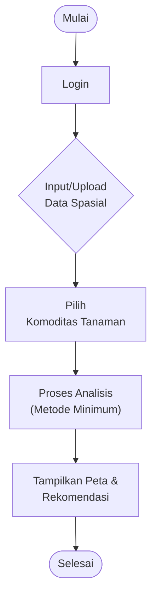
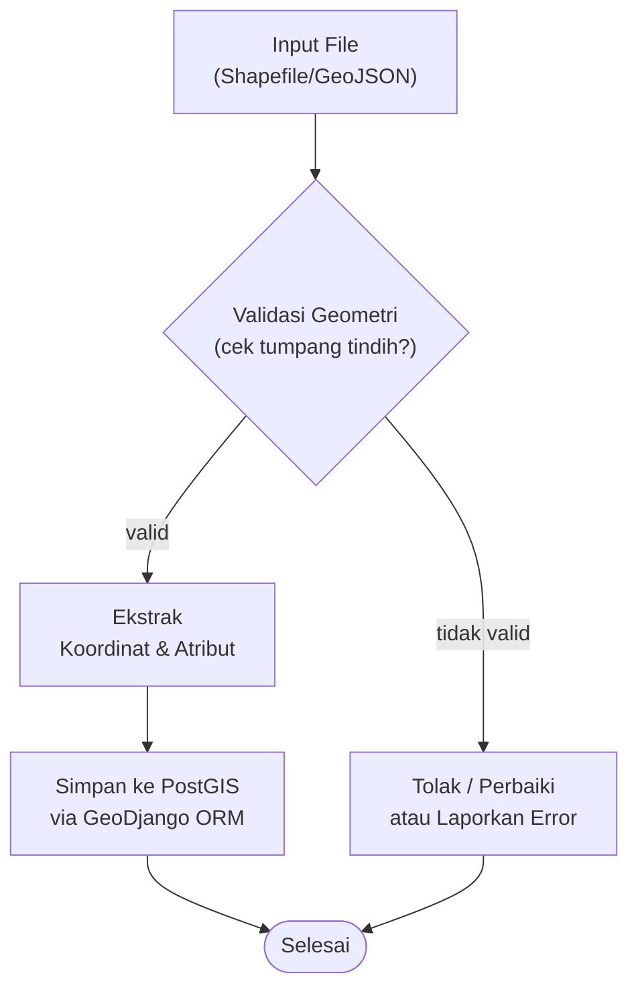

Bab 3  
Metode Penelitian dan Perancangan

### 3.1 Jenis Penelitian
Penelitian ini termasuk kategori Research and Development (R&D) karena tidak hanya mengkaji teori tetapi juga menghasilkan sebuah produk perangkat lunak berupa sistem WebGIS untuk analisis kesesuaian lahan dan rekomendasi pertanian. Pendekatan R&D memungkinkan penulis untuk merancang, mengembangkan, menguji, dan memodifikasi sistem berdasarkan umpan balik selama proses penelitian.

### 3.2 Model Pengembangan Sistem
Model pengembangan yang digunakan adalah **Prototype Iteratif**. Tahapan dimulai dengan pembuatan prototipe awal yang memuat fitur dasar (peta, pemilihan parameter, dan perhitungan kesesuaian sederhana). Prototipe ini diuji secara internal dan kemudian disempurnakan melalui beberapa iterasi sampai memenuhi kebutuhan fungsional dan non‑fungsional.

#### Flowchart Alur Global Sistem

Diagram berikut menggambarkan peta jalan pengguna dari masuk sampai menerima hasil rekomendasi. Setiap kotak mencerminkan fitur fungsional yang disebutkan di sub‑bab 3.3.



Diagram ini membantu menjelaskan alur logis di dalam prototipe yang terus dikembangkan: autentikasi → data masukan → pilih komoditas → hitung kesesuaian → tampilkan output.

### 3.3 Analisis Kebutuhan Sistem

Berdasarkan arsitektur sistem yang telah dirancang, analisis kebutuhan dibagi menjadi dua kelompok utama:

#### 3.3.1 Kebutuhan Fungsional

Kebutuhan fungsional mendefinisikan fitur-fitur utama yang harus dimiliki sistem untuk mendukung analisis kesesuaian lahan:

1. **Pengelolaan Master Data**
   - **Manajemen Komoditas**: CRUD (Create, Read, Update, Delete) untuk data komoditas pertanian yang dikelompokkan berdasarkan kategori (Pangan, Hortikultura, Perkebunan, Pakan Ternak). Setiap komoditas memiliki kriteria kesesuaian tersendiri.
   - **Kriteria Kesesuaian**: Pengelolaan parameter evaluasi untuk setiap komoditas dengan empat kelas FAO (S1, S2, S3, N). Contoh: untuk Padi, pH Tanah S1 = 6-7, S2 = 5-6, S3 = 4-5, N = <4.
   - **Tahun Data**: Manajemen periode pengumpulan data spasial dengan kemampuan menandai tahun default untuk analisis.
   - **Kategori Karakteristik Lahan**: Pengelompokan parameter (Kimia Tanah, Fisika Tanah, Iklim, Topografi) untuk organisasi yang lebih baik.

2. **Import dan Manajemen Data Spasial**
   - **Upload Shapefile/GeoJSON**: Sistem menerima file spasial dalam format ZIP (untuk shapefile) atau GeoJSON langsung melalui form `LayerUploadForm`.
   - **Validasi Geometri Otomatis**: Menggunakan GDAL/OGR untuk membaca dan memvalidasi geometri, dengan transformasi ke SRID 4326 (WGS84).
   - **Ekstraksi Fitur**: Setiap fitur dari shapefile diekstrak menjadi record `FeatureData` dengan geometri disimpan di PostGIS (`GeometryField`) dan atribut di `JSONField`.
   - **Kategorisasi Layer**: Layer diklasifikasikan sebagai `tanah`, `komoditas`, `base_analisis`, atau `lainnya` untuk filter dan organisasi.
   - **Publish ke GeoServer**: Integrasi otomatis dengan GeoServer untuk menampilkan layer via WMS/WFS menggunakan `GeoServerPublishing` model.

3. **Kalkulasi Kesesuaian Lahan**
   - **Metode Minimum (FAO)**: Implementasi prinsip faktor pembatas FAO di mana kelas overall ditentukan oleh parameter terburuk. Fungsi `calculate_minimum_class` memeriksa prioritas N > S3 > S2 > S1.
   - **Metode Weighted**: Perhitungan berbasis skor tertimbang dengan formula: `Skor = Σ(Score_i × Weight_i) / Σ(Weight_i)`. Kelas ditentukan dari range skor (S1: 3.5-4.0, S2: 2.5-3.5, S3: 1.5-2.5, N: 0.0-1.5).
   - **Metode Parametric**: Hybrid yang menggabungkan minimum dan weighted—jika ada kelas N, langsung return N; jika tidak, gunakan weighted method.
   - **Normalisasi Data Tanah**: Fungsi `extract_soil_data_from_feature` memetakan field shapefile (mis. `PH_NILAI` → `pH Tanah`) dan memproses format khusus (`">45%"` → `45.0`, `"0 - 110"` → `110.0`).

4. **Analisis Faktor Pembatas dan Rekomendasi**
   - **Deteksi Limiting Factors**: Identifikasi otomatis karakteristik dengan kelas S3 atau N yang menjadi faktor pembatas produktivitas.
   - **Solusi Perbaikan**: Model `LimitingFactor` menyimpan solusi teknis (dosis kapur, pupuk, dll.), estimasi biaya (`cost_value` + `cost_unit`), waktu pelaksanaan, dan prioritas.
   - **Rekomendasi Prioritas**: Sistem mengurutkan rekomendasi berdasarkan tingkat keparahan (N > S3 > S2) dan menampilkan top-N rekomendasi untuk pengguna.

5. **Peta Interaktif**
   - **Visualisasi Leaflet.js**: Menampilkan poligon hasil analisis dengan kode warna: S1 (hijau tua), S2 (hijau muda), S3 (kuning), N (merah).
   - **Popup Detail**: Klik poligon menampilkan informasi lengkap: kelas kesesuaian, skor, faktor pembatas, dan rekomendasi.
   - **Filter Komoditas**: Panel kiri memungkinkan pengguna beralih antar komoditas yang dianalisis untuk melihat perbandingan hasil.
   - **Legenda Dinamis**: Legenda peta menyesuaikan dengan kelas yang ditampilkan dan metode analisis yang digunakan.

6. **API untuk Integrasi**
   - **Batch Suitability Analysis API**: Endpoint `POST /analysis/api/analysis/suitability/batch/` menerima request dengan `commodity_ids`, `layer_id`, `method`, dan `include_limiting_factors`.
   - **Single Analysis API**: Endpoint `POST /analysis/api/analysis/suitability/` untuk analisis satu komoditas dengan data tanah langsung.
   - **Response Format**: JSON terstruktur dengan `overall_class`, `characteristics`, `limiting_factors`, `recommendations`, dan `class_distribution`.
   - **Error Handling**: Validasi input dan error message yang informatif untuk debugging integrasi.

7. **Manajemen Hasil Analisis**
   - **Penyimpanan Metadata**: Model `SuitabilityAnalysisResult` menyimpan metadata analisis (komoditas, layer, metode, tanggal, distribusi kelas).
   - **Tabel Hasil PostGIS**: Hasil per-fitur disimpan di tabel terpisah (`result_layer_name`) untuk query spasial efisien.
   - **History Analisis**: User dapat melihat riwayat analisis yang pernah dilakukan dengan filter berdasarkan komoditas dan tanggal.

8. **Autentikasi dan Otorisasi**
   - **Custom User Model**: Model `User` extends `AbstractUser` dengan field tambahan `full_name`.
   - **UserProfile**: Menyimpan preferensi user seperti `active_data_year` untuk konteks analisis.
   - **Role-Based Access**: Admin memiliki akses penuh (upload layer, manage master data), sedangkan regular user terbatas pada view dan analisis.

#### 3.3.2 Kebutuhan Non-Fungsional

Kebutuhan non-fungsional mendefinisikan kualitas sistem dan batasan teknis:

1. **Performa**
   - **Response Time**: Query sederhana (single feature lookup) harus selesai dalam <2 detik. Analisis batch untuk 1595 fitur (dataset riil) ditargetkan <10 detik dengan metode minimum.
   - **Caching**: Menggunakan Django cache framework dengan `CACHE_TIMEOUT = 3600` detik untuk commodity data dan karakteristik, mengurangi query database berulang.
   - **Query Optimization**: `select_related` dan `prefetch_related` pada queryset untuk menghindari masalah N+1 queries saat mengakses limiting factors.
   - **Background Processing**: Celery + Redis untuk tugas analisis besar yang dapat dijalankan secara asynchronous, mencegah blocking request-response.

2. **Keamanan**
   - **Django Authentication**: Sistem autentikasi built-in Django dengan session management dan password hashing (PBKDF2).
   - **CSRF Protection**: Django middleware CSRF protection untuk semua form POST.
   - **SQL Injection Prevention**: Django ORM dengan parameterized queries mencegah SQL injection.
   - **XSS Protection**: Auto-escaping template Django dan validasi input untuk mencegah Cross-Site Scripting.
   - **CORS Configuration**: `django-cors-headers` mengatur akses cross-origin untuk API yang diakses dari domain berbeda.

3. **Kompatibilitas Multi-Platform**
   - **Responsive Design**: Bootstrap 5 dengan grid system memastikan tampilan optimal di desktop (≥1200px), tablet (768-1199px), dan ponsel (<768px).
   - **HTMX untuk Interaksi**: Library HTMX memungkinkan update parsial tanpa reload halaman, mengurangi bandwidth dan meningkatkan UX di koneksi lambat.
   - **Browser Support**: Leaflet.js kompatibel dengan semua browser modern (Chrome, Firefox, Safari, Edge) tanpa perlu polyfill khusus.
   - **Progressive Enhancement**: Fitur dasar (view peta, analisis) tetap berfungsi tanpa JavaScript tingkat lanjut.

4. **Backup dan Restore Data**
   - **PostgreSQL Dump**: Command `pg_dump` untuk backup database lengkap termasuk ekstensi PostGIS dan data spasial.
   - **Media File Backup**: File SLD style dan upload shapefile disimpan di `media/` dan `mediafiles/` perlu di-backup terpisah.
   - **Docker Volume**: Jika menggunakan Docker Compose, volume PostgreSQL (`postgres_data`) harus di-mount ke host untuk persistence.
   - **Restore Procedure**: Dokumentasi prosedur restore termasuk langkah: restore database, collect static files, dan republish layers ke GeoServer.

5. **Skalabilitas**
   - **PostGIS Indexing**: Field `GeometryField` secara otomatis menggunakan GiST index untuk query spasial efisien pada dataset besar (≥10.000 fitur).
   - **JSONField Flexibility**: Atribut disimpan di `JSONField` memungkinkan penambahan parameter baru tanpa migrasi schema.
   - **Horizontal Scaling**: Arsitektur Django + GeoServer dapat di-deploy di multiple nodes dengan load balancer (Nginx) untuk menangani traffic tinggi.
   - **Database Connection Pooling**: `psycopg2` dengan connection pooling mengurangi overhead koneksi untuk concurrent requests.
   - **Static File Serving**: WhiteNoise untuk serving file statis langsung dari Django, mengurangi beban server produksi (Gunicorn).

6. **Maintainability**
   - **Modular Architecture**: Pemisahan apps (`core`, `master_data`, `spatial`, `analysis`) memudahkan maintenance dan testing independen.
   - **Type Hints**: Codebase menggunakan type hints Python (`def func(arg: int) -> str:`) untuk dokumentasi dan deteksi error dini.
   - **Logging**: Django logging framework mencatat error dan warning untuk debugging production issues.
   - **Testing Framework**: `pytest` + `pytest-django` dengan coverage reporting memastikan perubahan tidak merusak fungsionalitas existing.

7. **Usability**
   - **Feedback Visual**: Loading indicators saat analisis berjalan, success/error toasts setelah operasi CRUD.
   - **Error Messages**: Pesan error yang informatif dan actionable (mis. "File .shp tidak ditemukan dalam ZIP" bukan "Invalid file").
   - **Consistent UI**: Bootstrap 5 dengan tema konsisten di seluruh halaman, icon dari Bootstrap Icons untuk aksi (edit, delete, upload).

Tabel 3.1 merangkum prioritas kebutuhan fungsional berdasarkan MoSCoW method:

| ID | Fitur | Priority | Use Case |
|----|-------|----------|----------|
| F1 | Upload shapefile | Must | Admin upload layer unit lahan |
| F2 | Analisis minimum | Must | Hitung kesesuaian dengan FAO standard |
| F3 | Visualisasi peta | Must | Tampilkan hasil dengan warna S1-S3-N |
| F4 | Rekomendasi | Should | Tampilkan solusi untuk limiting factors |
| F5 | Weighted method | Should | Alternatif analisis dengan bobot |
| F6 | Export hasil | Could | Download report PDF/Excel |
| F7 | Batch analysis | Must | Analisis multi-komoditas sekaligus |
| F8 | History analisis | Should | Lihat riwayat analisis user |

**Tabel 3.1** Prioritas kebutuhan fungsional (Must = wajib, Should = seharusnya, Could = bisa nanti)

### 3.4 Perancangan Sistem
Desain visual dan struktural meliputi:

- **Use Case**: diagram yang menunjukkan aktor utama (petani/penyuluh, admin, sistem eksternal) serta interaksi seperti melihat peta, menginput parameter, dan memperoleh rekomendasi.

- **Arsitektur**: model client-server dengan frontend HTML/HTMX/Tailwind/Leaflet, backend Django/DRF/GeoDjango, dan database PostgreSQL/PostGIS; komponen opsional GeoServer untuk peta. File `settings.py` mendefinisikan aplikasi yang diinstal melalui `INSTALLED_APPS = DJANGO_APPS + THIRD_PARTY_APPS + LOCAL_APPS`, termasuk `'django.contrib.gis'` untuk dukungan PostGIS serta lokal apps seperti `spatial`, `master_data`, dan `analysis`.

- **Desain Database**: struktur diturunkan dari model-model Django yang didefinisikan dalam `spatial/models.py` serta `master_data/models.py`. Berikut ringkasan tabel utama dan relasinya:

  * `MasterLayer` – menyimpan metadata setiap layer spasial yang diunggah. Tabel ini berisi nama layer, tipe geometri (`point`, `polygon`, dll.), kategori, tahun data, dan atribut JSON. Relasi **One‑to‑Many** ke `FeatureData` (satu layer memiliki banyak fitur) dan ke `GeoServerPublishing` (one‑to‑one untuk status publikasi).

  * `GeoServerPublishing` – tabel pelacakan publikasi ke GeoServer. Mempunyai relasi **One‑to‑One** ke `MasterLayer`.

  * `LimitingFactor` – menyimpan solusi perbaikan lahan untuk kombinasi karakteristik dan kelas kesesuaian tertentu. Memiliki **ForeignKey** ke `master_data.SuitabilityCharacteristic`, sehingga setiap karakteristik dapat mempunyai beberapa solusi (One‑to‑Many). Relasi ini memudahkan pembuatan rekomendasi intervensi berdasarkan kelas S1–N.

  * `SuitabilityAnalysisResult` – metadata hasil analisis per komoditas dan layer input. Memiliki ForeignKey ke `master_data.Commodity` dan `MasterLayer`. Informasi statistik diperoleh dari tabel PostGIS terpisah (diwakili oleh nama tabel pada field `result_layer_name`).

  * **Administratif** (`Kabupaten`, `Kecamatan`, `Desa`) – hirarki wilayah; masing‑masing berelasi One‑to‑Many ke level di atasnya (desa → kecamatan → kabupaten) dan kabupaten terhubung ke `MasterLayer`.

  * `FeatureData` – menyimpan data fitur geometri untuk setiap polygon/point dari layer. Tabel ini menggunakan `gis_models.GeometryField` (SRID 4326) untuk menyimpan geometri secara native di PostGIS, dan `JSONField` untuk atribut fleksibel. Relasinya adalah **Many‑to‑One** ke `MasterLayer`.

  * Di `master_data/models.py` terdapat tabel seperti `Commodity`, `CommodityGroup`, `DataYear`, dan `LandCharacteristicCategory` yang berfungsi sebagai master data bagi parameter analisis. Relasi-relasi di sini memberi struktur referensi bagi model spasial (misalnya `MasterLayer.data_year` ForeignKey ke `DataYear`).

  Secara keseluruhan, desain database memanfaatkan kekuatan PostGIS untuk data spasial dan JSONField untuk fleksibilitas atribut. Relasi antara tabel ditangani dengan ForeignKey standar Django, sedangkan data spasial tersimpan pada field geometri (`GeometryField`) di tabel `FeatureData` dan juga dalam tabel hasil analisis (`result_layer_name`) yang dibentuk secara dinamis selama proses analisis.

  Diagram ERD dapat menggambarkan hubungan ini: MasterLayer ←– FeatureData; MasterLayer → GeoServerPublishing; Commodity ←– SuitabilityAnalysisResult → MasterLayer; dan sebagainya. Skema ini mendukung ekspansi (misalnya menambah karakteristik kesesuaian baru tanpa perlu perubahan struktur spasial) serta integrasi dengan modul lain.


### 3.5 Algoritma Analisis Kesesuaian dan Rekomendasi
Logika analisis kesesuaian lahan dalam sistem ini diimplementasikan menggunakan Metode Minimum FAO (FAO Minimum Method). Prinsip utama dari metode ini adalah bahwa kelas kesesuaian lahan keseluruhan ditentukan oleh parameter dengan nilai terendah (faktor pembatas).

#### 3.5.1 Prosedur Penentuan Kelas Kesesuaian
Proses penentuan kelas dilakukan melalui tahapan sistematis sebagai berikut:

1. **Kuantifikasi Parameter (Scoring):**
   Setiap parameter lahan (seperti curah hujan, drainase, atau pH tanah) diklasifikasikan ke dalam kategori kualitatif yang kemudian dikonversi menjadi nilai numerik sebagai berikut:
   - S1 (Sangat Sesuai): Skor 4
   - S2 (Cukup Sesuai): Skor 3
   - S3 (Sesuai Marginal): Skor 2
   - N (Tidak Sesuai): Skor 1
   - Unknown: Skor 0

2. **Penerapan Aturan Faktor Pembatas (Minimum Method):**
   Sesuai dengan kerangka FAO, sistem tidak menggunakan rata-rata hitung, melainkan mencari nilai minimum dari seluruh parameter yang diuji. Secara algoritmis, sistem melakukan pemindaian prioritas terhadap seluruh parameter pada unit lahan dengan urutan sebagai berikut:
   - Jika terdapat minimal satu parameter dengan kelas N, maka kelas akhir unit lahan adalah N.
   - Jika tidak ada kelas N, namun terdapat minimal satu parameter dengan kelas S3, maka kelas akhir adalah S3.
   - Jika tidak ada kelas N dan S3, namun terdapat kelas S2, maka kelas akhir adalah S2.
   - Kelas S1 hanya akan diberikan jika seluruh parameter yang dievaluasi berada pada kategori S1.

3. **Representasi Matematis:**
   Algoritma ini dapat dinyatakan dalam fungsi matematika sederhana sebagai berikut:
   \[ C_{akhir} = \min(C_1, C_2, ..., C_n) \]
   di mana $C_{akhir}$ adalah kelas kesesuaian akhir, dan $C_i$ adalah nilai skor dari masing-masing parameter lahan.

#### Diagram Logika Algoritma

Visualisasi berikut mempermudah memahami alur pemrosesan `calculate_minimum_class` yang menangkap prioritas faktor pembatas:

```mermaid
flowchart TD
    A([Mulai: daftar skor parameter]) --> B{Ada kelas N?}
    B -- Ya --> C[Iris: skor akhir = N]
    B -- Tidak --> D{Ada kelas S3?}
    D -- Ya --> E[Iris: skor akhir = S3]
    D -- Tidak --> F{Ada kelas S2?}
    F -- Ya --> G[Iris: skor akhir = S2]
    F -- Tidak --> H[Semua S1 \n(skor akhir = S1)]
    H --> I([Selesai])
    C --> I
    E --> I
    G --> I
```

Diagram menunjukkan jelas bagaimana satu faktor terburuk (N, lalu S3, dst.) langsung menentukan output klasifikasi.

#### 3.5.2 Logika Pemrograman Rekomendasi
Implementasi pada perangkat lunak dilakukan dengan fungsi `calculate_minimum_class` yang menerima masukan berupa kumpulan data parameter lahan dalam bentuk counter structure. Fungsi ini bekerja secara iteratif memeriksa daftar prioritas (priority list) yang telah ditentukan. Keuntungan penggunaan metode ini dalam sistem adalah konsistensi hasil evaluasi, di mana faktor lingkungan yang paling kritis (pembatas) akan selalu menjadi acuan utama dalam memberikan rekomendasi pertanian kepada pengguna.

### 3.6 Pengumpulan dan Pengolahan Data
Sumber data meliputi:
- **Data spasial**: peta poligon blok lahan dari Dinas Pertanian, diupload dalam format Shapefile/GeoJSON dan disimpan pada PostGIS.
- **Data atribut**: parameter tanah (hasil analisis laboratorium), data iklim stasiun, dan informasi tutupan lahan existing.

Proses pengolahan mencakup beberapa tahap yang diimplementasikan pada view `spatial/views/layer_views.py`:

#### Diagram Alur Pengolahan Data Spasial

Berikut flowchart yang menegaskan aliran data spasial khas WebGIS (GeoDjango + PostGIS):



1. **Penerimaan berkas** – pengguna mengunggah arsip ZIP yang berisi shapefile melalui form `LayerUploadForm`. Setelah validasi form sukses, fungsi `_handle_layer_upload` dipanggil.
2. **Ekstraksi & pencarian `.shp`** – arsip diekstrak ke direktori temporer. File `.shp` dicari di dalam folder dan menjadi input selanjutnya.
3. **Pembacaan dengan GDAL** – modul `django.contrib.gis.gdal.DataSource` membuka shapefile. Setiap fitur pada layer iterasi diambil, geometrinya ditransform ke SRID 4326, dan atributnya dikoleksi.
4. **Validasi geometri** – transformasi ke SRID standar akan memeriksa dan memperbaiki geometri dasar. Proses penyimpanan ke model `FeatureData` menggunakan field `GeometryField`; PostGIS secara otomatis melakukan validasi tambahan (misalnya memastikan polygon valid, tidak self‑intersect).
5. **Normalisasi atribut** – selain langkah ini terdapat fungsi `extract_soil_data` di `analysis/tasks.py` yang memetakan nama field dari shapefile ke nama yang dikenali sistem (mis. `PH_NILAI` → `pH Tanah`) dan memproses nilainya ke format yang konsisten. Meskipun normalisasi utama terjadi saat analisis, atribut awal disimpan sebagai JSON mentah dan dapat diubah kemudian.
6. **Penyimpanan** – setiap fitur dimasukkan ke tabel `FeatureData` sebagai record baru dengan field `layer` (FK ke `MasterLayer`), geometry, dan attributes JSON.
7. **Publikasi ke GeoServer** – setelah semua fitur tersimpan, helper `publish_layer_to_geoserver` dipanggil untuk membuat layer WMS/WFS sehingga data dapat ditampilkan di antarmuka.
8. **Pembersihan & error handling** – direktori temporer dihapus, dan apabila terjadi kesalahan semua perubahan dibatalkan.

Dengan alur ini, sistem menjamin bahwa data spasial yang masuk sudah melalui validasi geometri PostGIS, atribut distandarisasi, dan layer siap untuk analisis lebih lanjut. Apabila file GeoJSON juga diterima, logika serupa dapat digunakan (DataSource mendukung format selain shapefile) karena hanya mengandalkan GDAL untuk abstraksi format.

### 3.7 Lingkungan Pengembangan
Pengembangan dilakukan pada laptop dengan spesifikasi AMD RYZEN 7, 12 GB RAM, sistem operasi Windows 11. Pada dasarnya lingkungan dibangun menggunakan Python 3.10 dan paket‑paket yang tercantum dalam `requirements.txt`. Database utamanya adalah PostgreSQL 15 dengan ekstensi PostGIS 3.x.

Berikut tabel software/perpustakaan utama beserta fungsinya dalam sistem WebGIS:

| Paket / Library | Versi contoh | Fungsi dalam sistem |
|---|---|---|
| Django | 5.0.2 | Web framework utama; menyediakan ORM, routing, autentikasi, dan struktur MVC. |
| django-contrib-gis (GeoDjango) | 5.0.2 | Ekstensi spatial Django yang memungkinkan penggunaan field geometri, query spasial, dan integrasi PostGIS. |
| psycopg2-binary | 2.9.9 | Driver Python untuk PostgreSQL; diperlukan agar Django dapat terhubung ke database PostGIS. |
| GDAL | 3.8.4 | Library geospasial untuk membaca/menulis berbagai format berkas; digunakan saat mengimpor shapefile/GeoJSON. |
| djangorestframework & drf-gis | 3.14.0 / 1.0.2 | Membangun API RESTful; `drf-gis` menambahkan serializer dan filter khusus spatial. |
| requests | 2.31.0 | Membuat permintaan HTTP eksternal (misal: API cuaca). |
| celery / redis / django-redis | 5.3.6 / 5.0.1 / 5.4.0 | Menjalankan tugas background dan antrian, seperti perhitungan kesesuaian yang besar. |
| django-widget-tweaks, django-crispy-forms, crispy-bootstrap5 | 1.4.12, 2.1, 0.7 | Membantu rendering form HTML yang responsif dan estetis menggunakan Bootstrap 5. |
| django-cors-headers | 4.3.1 | Mengizinkan permintaan Cross-Origin, berguna saat API diakses dari domain lain. |
| django-extensions | 3.2.3 | Menyediakan perintah tambahan (shell_plus, graph_models) untuk pengembangan. |
| Pillow | 10.2.0 | Pengolahan gambar (misal thumbnail). |
| python-decouple | 3.8 | Mengelola konfigurasi lewat `.env`. |
| openpyxl, pandas, geopandas | 3.1.2, 2.2.1, 0.14.1 | Pemrosesan data tabel dan spasial; `geopandas` memudahkan operasi geometri di Python. |
| django-debug-toolbar | 4.2.0 | Alat debugging selama development. |
| pytest, pytest-django, coverage | 8.0.0, 4.8.0, 7.4.3 | Framework dan metrik untuk pengujian otomatis kode. |
| black, flake8 | 24.2.0, 7.0.0 | Formatter dan linter untuk menjaga konsistensi kode. |
| gunicorn | 21.2.0 | Server WSGI produksi ketika aplikasi dideploy. |
| whitenoise | 6.6.0 | Menyajikan file statis dalam mode produksi tanpa memerlukan server terpisah.

Secara ringkas, paket‑paket ini mendukung fungsionalitas WebGIS yang lengkap: dari manajemen data spasial (GeoDjango, GDAL) sampai antarmuka pengguna dinamis (HTMX, Leaflet melalui package JS) dan pemrosesan background serta API.

### 3.8 Metode Pengujian Sistem
Pengujian dilakukan dalam beberapa tahap:
- **Black Box Testing**: memeriksa fungsionalitas tanpa melihat kode, memastikan semua use case berjalan sesuai deskripsi.
- **Uji Performa**: mengukur waktu respon query spasial dan beban server saat menjalankan analisis pada dataset besar (misalnya, 10.000 unit lahan).
- **Uji Coba Pengguna**: melibatkan sekelompok petani/penyuluh untuk mencoba prototipe dan memberikan masukan mengenai kegunaan antarmuka serta validitas rekomendasi.

Dokumentasi hasil pengujian akan disajikan dalam Bab 4 sebagai bagian dari evaluasi sistem.
