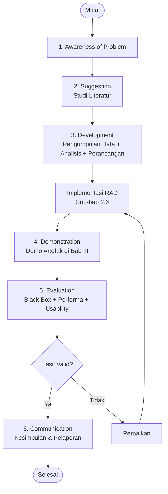
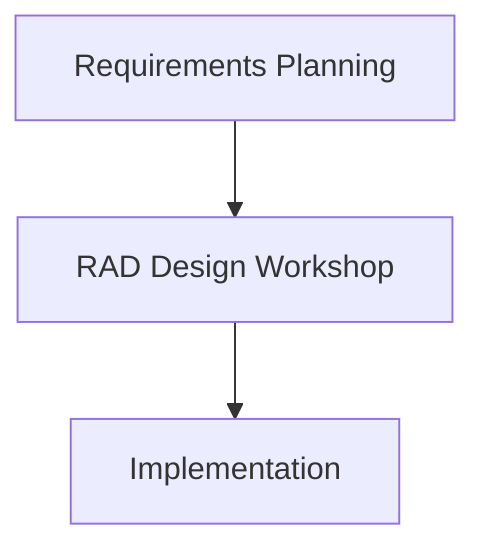
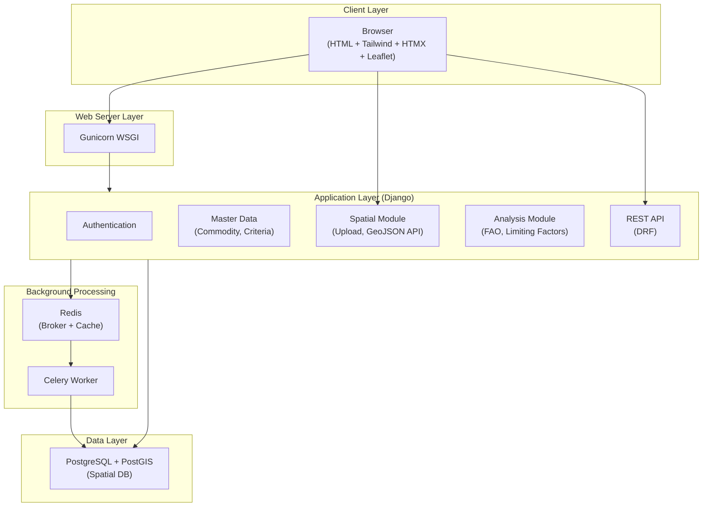
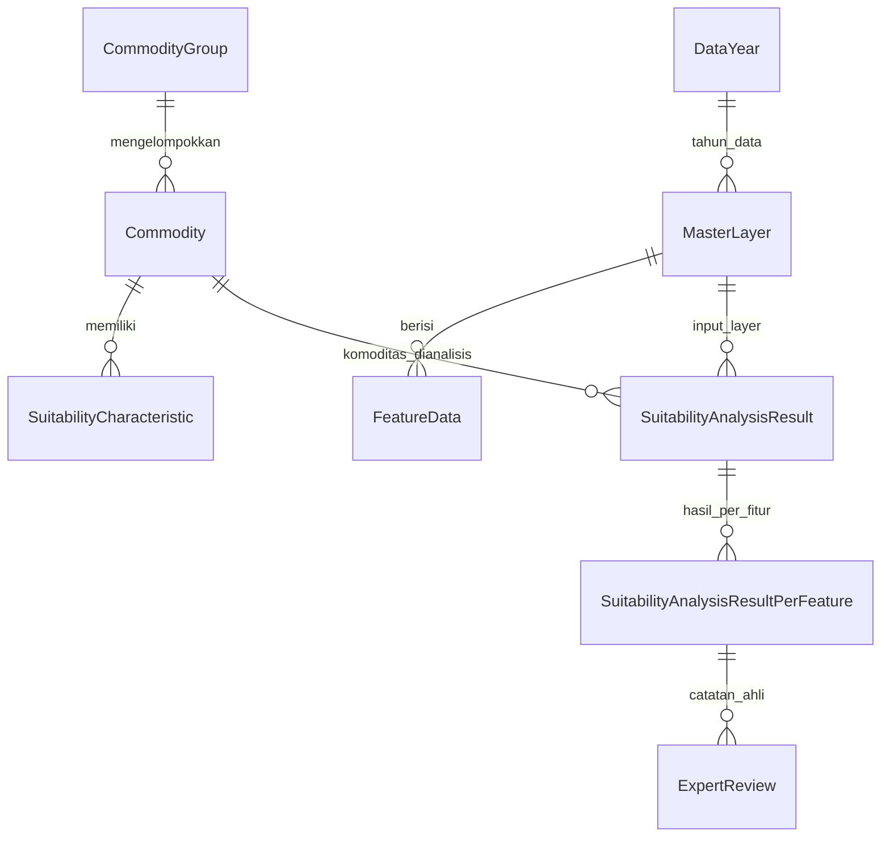
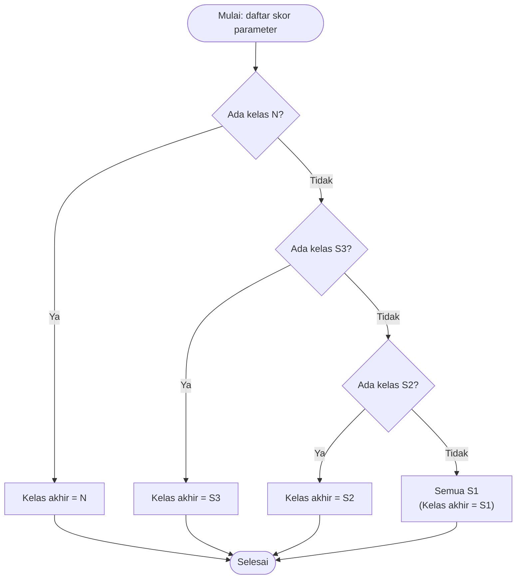

# BAB II
## METODE PENELITIAN

### 2.1 Waktu dan Lokasi Penelitian

#### 2.1.1 Waktu Penelitian

Penelitian ini dilaksanakan dalam rentang waktu **November 2025 hingga Juli 2026**, bertempat di Laboratorium Komputasi serta dilakukan secara mandiri (*remote*) dengan dukungan infrastruktur *cloud* dan *local development environment*.

#### 2.1.2 Lokasi Penelitian

Lokasi studi yang menjadi objek analisis adalah **Kabupaten Barru, Provinsi Sulawesi Selatan**. Kabupaten Barru memiliki luas wilayah **1.174 km²** dan secara administratif terdiri dari **7 kecamatan**, yaitu: Tanete Rilau, Tanete Riaja, Barru, Soppeng Riaja, Mallusetasi, Pujananting, dan Balusu. Pemilihan Kabupaten Barru sebagai lokasi studi didasarkan pada ketersediaan data spasial yang lengkap dan representatif, mencakup parameter tanah, iklim, dan topografi yang dibutuhkan dalam analisis kesesuaian lahan.

### 2.2 Kerangka Kerja Design Science Research (DSR)

#### 2.2.1 Konsep Design Science Research

*Design Science Research* (DSR) adalah paradigma penelitian yang berfokus pada penciptaan dan evaluasi artefak untuk memecahkan masalah yang teridentifikasi (Hevner et al., 2004). Berbeda dengan penelitian *behavioral science* yang berfokus pada pengujian teori, DSR berorientasi pada pengembangan solusi berbasis teknologi yang dapat diukur efektivitasnya.

Menurut Peffers et al. (2007), *Design Science Research Methodology* (DSRM) menyediakan kerangka kerja sistematis yang terdiri dari enam tahapan iteratif. DSRM menyediakan panduan yang jelas mulai dari identifikasi masalah hingga komunikasi hasil, sehingga cocok diterapkan pada penelitian yang menghasilkan artefak teknologi informasi.

#### 2.2.2 Hubungan antara Hevner 7 Guidelines dengan Peffers 6 Tahapan DSR

Hevner et al. (2004) merumuskan tujuh pedoman (*guidelines*) untuk pelaksanaan *Design Science Research* yang efektif, yaitu: (1) *Design as an Artifact*, (2) *Problem Relevance*, (3) *Design Evaluation*, (4) *Research Contributions*, (5) *Research Rigor*, (6) *Design as a Search Process*, dan (7) *Communication of Research*. Ketujuh pedoman ini saling melengkapi dengan enam tahapan DSRM yang dirumuskan oleh Peffers et al. (2007).

Hubungan antara keduanya terletak pada keselarasan fokus: *guidelines* Hevner menekankan pada prinsip-prinsip kualitas yang harus dipenuhi dalam setiap tahapan DSRM, sedangkan tahapan Peffers menyediakan urutan proses yang sistematis. Sebagai contoh, *guideline* "Problem Relevance" Hevner berkorespondensi dengan tahap "Problem Identification & Motivation" Peffers, sementara "Design Evaluation" Hevner selaras dengan tahap "Evaluation" Peffers. Integrasi kedua kerangka ini memastikan bahwa penelitian tidak hanya mengikuti proses yang terstruktur, tetapi juga memenuhi standar kualitas akademik yang ketat.

#### 2.2.3 Alasan Penggunaan DSR

DSRM dipilih sebagai paradigma penelitian ini karena:

1. Penelitian ini menghasilkan artefak berupa **sistem informasi kesesuaian lahan** berbasis *FAO Minimum Method* yang dapat digunakan untuk mengklasifikasikan kesesuaian lahan pertanian di Kabupaten Barru.
2. Sistem yang dihasilkan bersifat inovatif karena mengintegrasikan teknologi WebGIS (Django + PostGIS + Leaflet) dengan algoritma evaluasi lahan standar FAO.
3. DSRM menyediakan tahapan evaluasi yang memungkinkan pengukuran kinerja artefak secara kuantitatif — dalam hal ini **uji akurasi** (membandingkan output sistem dengan perhitungan manual) dan **uji performa** (mengukur waktu respons pada beban 100 hingga 1.595 fitur).

#### 2.2.4 Enam Tahapan Design Science Research (Peffers et al., 2007)

Peffers et al. (2007) mendefinisikan enam tahapan DSRM yang diadaptasi dalam penelitian ini sebagai berikut:

| Tahapan DSRM | Implementasi dalam Penelitian |
|--------------|------------------------------|
| **1. Problem Identification & Motivation** | Identifikasi permasalahan: penentuan kelas kesesuaian lahan masih dilakukan secara manual menggunakan *spreadsheet*, tidak terintegrasi dengan data spasial, dan tidak memiliki visualisasi peta. Motivasi: menyediakan sistem otomatis yang mengadopsi standar FAO. |
| **2. Define Objectives of a Solution** | Menetapkan tujuan solusi: mengembangkan sistem WebGIS yang mampu mengimplementasikan *FAO Minimum Method*, menampilkan visualisasi peta interaktif dengan kode warna S1–N, menyediakan fitur input tenaga ahli, dan mengelola data master komoditas secara terintegrasi. Tujuan dijabarkan dalam kebutuhan fungsional (F1–F9) pada sub-bab 2.7. |
| **3. Design & Development** | Merancang dan membangun artefak sistem menggunakan metode pengembangan **RAD (Rapid Application Development)** yang dijelaskan pada sub-bab 2.6. Tahapan ini mencakup perancangan arsitektur, database, algoritma, dan antarmuka pengguna. |
| **4. Demonstration** | Mendemonstrasikan artefak melalui tangkapan layar (*screenshot*) dan deskripsi fitur pada Bab III: dashboard, manajemen data master, upload layer spasial, form analisis, halaman peta interaktif, control center, dan drawer input tenaga ahli. |
| **5. Evaluation** | Mengevaluasi kinerja artefak melalui tiga metode: (1) *Black box testing* untuk validasi fungsionalitas, (2) uji performa untuk mengukur *response time* pada berbagai beban fitur (100, 500, 1.000, 1595), dan (3) uji coba pengguna (*usability testing*) dengan kuesioner skala Likert. Dijelaskan lebih detail pada sub-bab 2.10. |
| **6. Communication** | Mengomunikasikan hasil penelitian melalui laporan skripsi dan publikasi ilmiah. Kesimpulan dan saran disajikan pada Bab IV. |

*Sumber: Diadaptasi dari Peffers et al. (2007)*

#### 2.2.5 Integrasi DSR dan Metode Agile

DSRM digunakan sebagai kerangka kerja penelitian secara keseluruhan, sedangkan RAD digunakan sebagai metode teknis dalam tahap **Design & Development** (tahap ke-3 DSRM). Integrasi ini memungkinkan proses pengembangan sistem yang iteratif dan cepat, sambil tetap menjaga *rigour* akademik melalui tahapan DSRM yang terstruktur. Setiap sprint RAD berkorespondensi dengan siklus *build-and-evaluate* dalam DSRM, di mana hasil setiap sprint dievaluasi sebelum melanjutkan ke sprint berikutnya.

### 2.3 Metode Pengumpulan Data

Data yang digunakan dalam penelitian ini seluruhnya merupakan **data sekunder** yang diperoleh dari **Laboratorium Manajemen dan Pelayanan Publik (LMPP) Universitas Hasanuddin (UNHAS)**. Data tersebut mencakup dua kategori utama:

#### 2.3.1 Data Spasial

Data spasial yang digunakan berupa *shapefile* (format `.shp`) yang mencakup wilayah Kabupaten Barru. Seluruh data memiliki sistem koordinat geografis WGS 84 (EPSG:4326). Rincian data spasial yang digunakan disajikan pada Tabel 2.1.

**Tabel 2.1** Data Spasial yang Digunakan dalam Penelitian

| No | Nama Data | Tipe Geometri | Jumlah Fitur | Kategori | Sumber |
|----|-----------|---------------|--------------|----------|--------|
| 1 | Admin_Desa | Polygon | 54 | Administratif | LMPP UNHAS |
| 2 | Unit_Lahan_OK | Polygon | 1.595 | Base Analisis | LMPP UNHAS |
| 3 | pH | Polygon | — | Kimia Tanah | LMPP UNHAS |
| 4 | C_Org | Polygon | — | Kimia Tanah | LMPP UNHAS |
| 5 | KTK | Polygon | — | Kimia Tanah | LMPP UNHAS |
| 6 | Kalium | Polygon | — | Kimia Tanah | LMPP UNHAS |
| 7 | Tekstur | Polygon | — | Fisika Tanah | LMPP UNHAS |
| 8 | Bulk_Density | Polygon | — | Fisika Tanah | LMPP UNHAS |
| 9 | Drainase | Polygon | — | Fisika Tanah | LMPP UNHAS |
| 10 | Kedalaman_Tanah | Polygon | — | Fisika Tanah | LMPP UNHAS |
| 11 | Batuan_Permukaan | Polygon | — | Fisika Tanah | LMPP UNHAS |
| 12 | Kemiringan_Lereng | Polygon | — | Topografi | LMPP UNHAS |
| 13 | Curah_Hujan | Polygon | — | Iklim | LMPP UNHAS |
| 14 | Banjir | Polygon | — | Kebencanaan | LMPP UNHAS |
| 15 | Longsor | Polygon | — | Kebencanaan | LMPP UNHAS |
| 16 | Kawasan_Hutan | Polygon | — | Tata Ruang | LMPP UNHAS |
| 17 | Pola_Ruang | Polygon | — | Tata Ruang | LMPP UNHAS |
| 18 | Sawah | Polygon | — | Penggunaan Lahan | LMPP UNHAS |

#### 2.3.2 Data Atribut dan Kriteria Kesesuaian

Data atribut karakteristik lahan tersimpan dalam *field* atribut setiap fitur shapefile. Setiap poligon unit lahan memiliki nilai untuk parameter-parameter seperti pH tanah (field `PH_NILAI`), C-Organik (`CORG_NILAI`), Kapasitas Tukar Kation (`KTK_NILAI`), tekstur tanah (`TEKSTUR`), kemiringan lereng (`KL`), dan kedalaman tanah efektif (`DALAM_TNH`).

Kriteria kesesuaian lahan untuk setiap komoditas mengacu pada tabel kriteria yang disusun oleh Djaenudin et al. (2011) yang mengadopsi kerangka FAO. Kriteria ini mencakup *threshold* numerik dan kategorikal untuk empat kelas kesesuaian (S1, S2, S3, N) pada setiap parameter lahan.

### 2.4 Instrumen Penelitian

Instrumen yang digunakan dalam penelitian ini terdiri dari perangkat keras (*hardware*), perangkat lunak (*software*), dan instrumen pengujian.

#### 2.4.1 Perangkat Keras

Pengembangan dan pengujian sistem dilakukan pada sebuah laptop dengan spesifikasi sebagai berikut:

- **Prosesor:** AMD Ryzen 7
- **Memori (RAM):** 20 GB
- **Penyimpanan:** SSD
- **Sistem Operasi:** Windows 11

#### 2.4.2 Perangkat Lunak

Perangkat lunak yang digunakan dalam pengembangan sistem dirangkum pada Tabel 2.2.

**Tabel 2.2** Perangkat Lunak Pengembangan Sistem

| Komponen | Teknologi | Versi | Fungsi |
|----------|-----------|-------|--------|
| Bahasa Pemrograman | Python | 3.10 | Bahasa utama pengembangan |
| Web Framework | Django | 5.0.2 | Backend framework (MVT, ORM, Auth) |
| Ekstensi Spasial | GeoDjango | 5.0.2 | Field geometri, query spasial, integrasi GDAL |
| Database | PostgreSQL | 15 | Database relasional utama |
| Ekstensi Spasial DB | PostGIS | 3.x | Tipe data geometri, fungsi spasial, indeks GiST |
| GeoJSON API | Django REST Framework | 3.14.0 | API endpoint untuk menyajikan layer spasial ke Leaflet |
| Message Broker | Redis | 7.x | Broker untuk Celery + cache backend |
| Task Queue | Celery | 5.3.6 | Pemrosesan analisis secara asynchronous |
| Web Server | Gunicorn | 21.2.0 | WSGI server untuk production |
| Pustaka Peta | Leaflet | 1.9.4 | Visualisasi peta interaktif di frontend |
| Interaksi Dinamis | HTMX | 1.9+ | AJAX partial update tanpa JavaScript kustom |
| CSS Framework | Tailwind CSS | 3.x | Utility-first styling responsif |
| REST API + GeoJSON | Django REST Framework | 3.14.0 | Serializer, viewsets, API endpoints + GeoJSON API untuk Leaflet |
| GIS Library | GDAL | 3.8.4 | Membaca/menulis format data vektor |
| Data Processing | GeoPandas | 0.14.1 | Operasi geometri di Python |

#### 2.4.3 Instrumen Pengujian

Instrumen pengujian yang digunakan meliputi:

1. **Test case black box** — serangkaian skenario pengujian fungsional untuk memverifikasi setiap fitur sistem berjalan sesuai spesifikasi.
2. **Browser DevTools (Network tab)** — untuk mengukur waktu respons (*response time*) setiap *request* API analisis.
3. **Task Manager Windows** — untuk memonitor penggunaan CPU dan memori selama proses analisis berlangsung.
4. **Kuesioner usability** — menggunakan skala Likert 1–5 untuk mengukur tingkat kepuasan dan kemudahan penggunaan sistem oleh responden.

### 2.5 Tahapan Penelitian

Penelitian ini dilaksanakan melalui serangkaian tahapan sistematis yang digambarkan dalam diagram alur pada Gambar 2.1.

**Gambar 2.1** Diagram Alur Tahapan Penelitian Berbasis DSRM (Peffers et al., 2007)

#### 2.5.1 Tahap Identifikasi Masalah

Mengidentifikasi permasalahan dalam proses analisis kesesuaian lahan pertanian yang masih dilakukan secara manual menggunakan *spreadsheet* dan tidak terintegrasi dengan data spasial, serta merumuskan kebutuhan akan sistem WebGIS yang mengadopsi standar FAO.

#### 2.5.2 Tahap Pengumpulan Data

Mengumpulkan data spasial dari LMPP UNHAS yang mencakup 18 layer tematik (administrasi, tanah, iklim, topografi, tata ruang) serta data kriteria kesesuaian lahan dari Djaenudin et al. (2011). Data yang terkumpul kemudian diverifikasi kelengkapan atribut dan konsistensi sistem koordinatnya.

#### 2.5.3 Tahap Analisis Kebutuhan

Menganalisis kebutuhan fungsional (F1–F9) dan non-fungsional sistem berdasarkan hasil identifikasi masalah dan studi literatur. Kebutuhan fungsional mencakup pengelolaan data master, import data spasial, kalkulasi kesesuaian lahan, input tenaga ahli, peta interaktif, autentikasi dan otorisasi, serta monitoring hasil analisis. Rincian kebutuhan dijabarkan pada sub-bab 2.7.

#### 2.5.4 Tahap Perancangan Sistem

Merancang arsitektur sistem *client-server* dengan lima lapisan utama (*client*, *web server*, *application*, *background processing*, *data*), merancang struktur database relasional dan spasial (PostgreSQL + PostGIS), merancang algoritma *FAO Minimum Method*, serta merancang antarmuka pengguna. Rincian perancangan dijabarkan pada sub-bab 2.8.

#### 2.5.5 Tahap Pengembangan Sistem

Mengimplementasikan rancangan sistem menggunakan metode RAD (*Rapid Application Development*) yang terdiri dari empat fase: *Requirements Planning*, *User Design*, *Construction*, dan *Cutover*. Pengembangan dilakukan secara iteratif dalam beberapa sprint. Rincian metode RAD dijabarkan pada sub-bab 2.6.

#### 2.5.6 Tahap Pengujian Sistem

Melakukan pengujian fungsional (*black box testing*) untuk memverifikasi setiap fitur sistem berjalan sesuai spesifikasi kebutuhan. Setiap test case dicatat dengan status berhasil atau gagal beserta catatan perbaikan jika ditemukan *bug*.

#### 2.5.7 Tahap Evaluasi

Melakukan evaluasi kinerja artefak melalui uji performa (*response time* pada beban 100–1.595 fitur) dan uji coba pengguna (*usability testing* dengan kuesioner skala Likert). Hasil evaluasi digunakan untuk menilai efektivitas sistem dan sebagai dasar penarikan kesimpulan. Rincian metode evaluasi dijabarkan pada sub-bab 2.10.

#### 2.5.8 Tahap Penyusunan Laporan

Menarik kesimpulan berdasarkan hasil evaluasi dan menyusun laporan akhir penelitian (Bab IV) yang mencakup kesimpulan dan saran untuk pengembangan lebih lanjut.

### 2.6 Metode Pengembangan Sistem (Rapid Application Development)

#### 2.6.1 Konsep RAD

Metode pengembangan sistem yang digunakan dalam penelitian ini adalah **RAD (Rapid Application Development)**. Menurut Kendall & Kendall (2020), RAD adalah pendekatan pengembangan perangkat lunak yang menekankan siklus pengembangan yang cepat dengan keterlibatan pengguna secara intensif melalui proses iteratif.

#### 2.6.2 Alasan Pemilihan RAD

RAD dipilih sebagai metode pengembangan sistem karena:

1. **Pengembangan yang cepat** — setiap komponen sistem dapat dibangun dalam siklus pendek (*time-boxed*), memungkinkan prototipe fungsional tersedia lebih awal.
2. **Fleksibilitas terhadap perubahan** — umpan balik dari pengguna dapat langsung diintegrasikan ke dalam iterasi berikutnya.
3. **Kesesuaian dengan DSRM** — siklus RAD *build-and-evaluate* selaras dengan tahapan *Design & Development* dan *Evaluation* dalam DSRM Peffers.

#### 2.6.3 Tahapan Pengembangan RAD

RAD diimplementasikan dalam tiga fase utama yang disesuaikan dengan kebutuhan pengembangan sistem WebGIS:

**Gambar 2.2** Tiga Fase RAD (Kendall & Kendall, 2020)

Penjelasan setiap fase RAD yang diterapkan dalam penelitian ini:

**A. Requirements Planning (Perencanaan Kebutuhan)**

Fase ini bertujuan untuk mengidentifikasi dan mendefinisikan kebutuhan sistem secara menyeluruh. Aktivitas yang dilakukan meliputi:

1. **Studi literatur** terhadap kerangka evaluasi lahan FAO, DSRM (Peffers et al., 2007), metode analisis kesesuaian, dan teknologi WebGIS yang relevan.
2. **Analisis data spasial** yang tersedia — memeriksa struktur *field* atribut shapefile, tipe data, dan format nilai untuk menentukan strategi normalisasi dan *mapping* data.
3. **Identifikasi kebutuhan fungsional** — mendefinisikan fitur-fitur yang harus dimiliki sistem: manajemen data master (komoditas, kriteria kesesuaian), upload dan manajemen data spasial, analisis kesesuaian lahan, peta interaktif, input tenaga ahli, dan manajemen hasil analisis.
4. **Identifikasi kebutuhan non-fungsional** — menetapkan target performa, standar keamanan (autentikasi Django, CSRF protection), dan kompatibilitas multi-platform.

*Deliverable* fase ini adalah spesifikasi kebutuhan sistem yang mencakup kebutuhan fungsional (F1–F9) dan non-fungsional.

**B. RAD Design Workshop (Lokakarya Desain)**

Fase ini merupakan inti dari pendekatan RAD yang menekankan keterlibatan pengguna secara intensif dalam proses perancangan. Aktivitas yang dilakukan meliputi:

1. **Perancangan arsitektur sistem** — mendefinisikan arsitektur *client-server* dengan komponen: *frontend* (HTML, Tailwind CSS, HTMX, Leaflet), *backend* (Django, GeoDjango), *database* (PostgreSQL + PostGIS), dan *task queue* (Celery + Redis). Sistem tidak menggunakan GeoServer — sebagai gantinya, data spasial disajikan melalui GeoJSON API yang langsung dirender oleh Leaflet.
2. **Perancangan database** — mendesain model data relasional dan spasial meliputi: tabel master (`Commodity`, `CommodityGroup`, `SuitabilityCharacteristic`, `DataYear`), tabel spasial (`MasterLayer`, `FeatureData`), dan tabel analisis (`SuitabilityAnalysisResult`, `SuitabilityAnalysisResultPerFeature`, `ExpertReview`).
3. **Perancangan algoritma** — mendesain alur logika *FAO Minimum Method* dengan prioritas N > S3 > S2 > S1, termasuk mekanisme normalisasi data dan pemetaan *field* dinamis.
4. **Perancangan antarmuka** — mendesain *wireframe* dan *mockup* untuk tujuh halaman utama sistem: login, dashboard, manajemen data master, manajemen data spasial, control center, peta interaktif, dan manajemen hasil analisis.

**C. Implementation (Implementasi)**

Fase ini mencakup seluruh aktivitas konstruksi teknis, pengujian, dan penyerahan sistem. Aktivitas yang dilakukan meliputi:

1. **Setup environment** — konfigurasi Django project, PostgreSQL + PostGIS, Redis, dan Celery.
2. **Implementasi model dan database** — membuat model Django untuk seluruh tabel master, spasial, dan analisis, termasuk `GeometryField` untuk data geospasial.
3. **Implementasi modul analisis** — membangun *class* `SuitabilityAnalyzer` yang mengimplementasikan *FAO Minimum Method* dan *Celery task* `run_simple_analysis` untuk pemrosesan *asynchronous*.
4. **Implementasi REST API dan GeoJSON API** — membangun endpoint API menggunakan Django REST Framework untuk operasi CRUD dan penyajian data spasial dalam format GeoJSON.
5. **Implementasi frontend** — membangun antarmuka pengguna dengan Tailwind CSS, HTMX untuk interaksi dinamis, dan Leaflet untuk visualisasi peta interaktif.
6. **Pengujian sistem** — melakukan *black box testing*, uji performa, dan *usability testing*.
7. **Perbaikan bug** — memperbaiki kesalahan yang ditemukan selama pengujian.
8. **Deployment** — menyiapkan sistem untuk lingkungan produksi menggunakan Gunicorn sebagai WSGI server.
9. **Dokumentasi** — menyusun dokumentasi teknis dan laporan penelitian.

#### 2.6.4 Pembagian Sprint Pengembangan Sistem

Pengembangan sistem dalam fase *Implementation* RAD dibagi ke dalam beberapa sprint iteratif. Setiap sprint berdurasi pendek dan menghasilkan *increment* fungsional yang dapat didemonstrasikan. Pembagian sprint dalam penelitian ini adalah sebagai berikut:

| Sprint | Fokus Pengembangan | Deliverable |
|--------|-------------------|-------------|
| **Sprint 1** | Setup environment dan modul IAM | Project Django terinisialisasi, database terkoneksi, sistem autentikasi dan manajemen role berjalan |
| **Sprint 2** | Modul Master Data | CRUD komoditas, grup komoditas, kriteria kesesuaian, dan limiting factor melalui antarmuka modal HTMX |
| **Sprint 3** | Modul Spasial | Upload shapefile/GeoJSON, ekstraksi fitur ke PostGIS, manajemen layer dengan toggle aktif/nonaktif |
| **Sprint 4** | Modul Analisis | Implementasi FAO Minimum Method, Celery task untuk analisis asynchronous, control center dengan progress bar |
| **Sprint 5** | Peta Interaktif & Expert Review | Halaman peta dengan GeoJSON layer, popup detail, drawer input tenaga ahli, kode warna S1–N |
| **Sprint 6** | Dashboard, Finalisasi & Pengujian | Dashboard dengan statistik, perbaikan bug, black box testing, uji performa, usability testing |

### 2.7 Analisis Kebutuhan Sistem

Analisis kebutuhan sistem dilakukan untuk mendefinisikan fitur-fitur yang harus dimiliki sistem agar dapat memenuhi tujuan penelitian. Kebutuhan sistem dibagi menjadi tiga kategori: kebutuhan fungsional, kebutuhan non-fungsional, dan kebutuhan pengguna berdasarkan peran.

#### 2.7.1 Kebutuhan Fungsional

Berdasarkan hasil identifikasi masalah dan studi literatur, kebutuhan fungsional sistem dirumuskan sebagai berikut:

1. **F1 — Pengelolaan Data Master** — Sistem harus menyediakan antarmuka CRUD (*Create, Read, Update, Delete*) untuk data komoditas pertanian yang dikelompokkan berdasarkan kategori (Pangan, Hortikultura, Perkebunan, Pakan Ternak). Setiap komoditas memiliki kriteria kesesuaian dengan empat kelas FAO (S1, S2, S3, N) yang dapat dikelola melalui panel manajemen terpadu. Admin dan Tenaga Ahli memiliki akses penuh terhadap pengelolaan data master, mengingat Tenaga Ahli merupakan praktisi yang paling memahami karakteristik agronomis setiap komoditas.

2. **F2 — Import dan Manajemen Data Spasial** — Sistem harus menerima *upload* file spasial dalam format Shapefile (ZIP) atau GeoJSON, memvalidasi geometri menggunakan GDAL, mengekstrak fitur menjadi *record* `FeatureData` dengan geometri disimpan di PostGIS dan atribut di `JSONField`, serta menyajikan layer melalui GeoJSON API.

3. **F3 — Kalkulasi Kesesuaian Lahan** — Sistem harus mengimplementasikan *FAO Minimum Method* di mana kelas *overall* ditentukan oleh parameter terburuk (prioritas N > S3 > S2 > S1), menangani normalisasi data tanah melalui pemetaan *field* dinamis, dan memproses format khusus (`">45%"` → `45.0`, `"0 - 110"` → `110.0`). Admin dan Tenaga Ahli dapat menjalankan analisis, sehingga Tenaga Ahli tidak hanya memvalidasi hasil tetapi juga dapat menginisiasi analisis secara mandiri berdasarkan pengetahuan lapangan yang dimiliki.

4. **F4 — Input Tenaga Ahli (Expert Review)** — Sistem harus menyediakan fitur bagi tenaga ahli pertanian untuk memberikan catatan lapangan (*ground truth*) pada setiap poligon hasil analisis. Setiap ahli hanya dapat memberikan satu catatan per poligon. Catatan ditampilkan melalui *drawer* panel di halaman peta interaktif.

5. **F5 — Peta Interaktif** — Sistem harus menampilkan poligon hasil analisis dengan kode warna: S1 (hijau tua), S2 (hijau muda), S3 (jingga), N (merah). *Popup* detail harus muncul saat pengguna mengklik poligon, menampilkan kelas kesesuaian, skor, dan hasil per karakteristik.

6. **F6 — Autentikasi, Otorisasi, dan Manajemen Akses** — Sistem harus memiliki mekanisme *login* berbasis Django *authentication* dengan *role-based access control* melalui modul IAM. Admin memiliki akses penuh, tenaga ahli dapat memberikan input pada hasil analisis, sedangkan *guest* terbatas pada melihat data.

7. **F7 — Monitoring dan Manajemen Hasil** — Sistem harus menyediakan *Control Center* untuk memantau progres analisis secara *real-time*, menampilkan status (pending/processing/completed/failed), serta menyediakan fitur *toggle* aktif/nonaktif untuk mengontrol tampilan layer dan hasil analisis di peta interaktif.

8. **F8 — Dashboard dan Ringkasan** — Sistem harus menampilkan ringkasan statistik pada halaman dashboard: jumlah layer aktif, total komoditas, hasil analisis (total/selesai/aktif), dan jumlah review tenaga ahli.

9. **F9 — Visualisasi Hasil Analisis** — Sistem harus menyediakan visualisasi hasil analisis dalam bentuk peta interaktif dengan kode warna S1–N, popup detail per poligon, dan legend kelas kesesuaian yang mudah diinterpretasi oleh pengguna.

#### 2.7.2 Kebutuhan Non-Fungsional

Kebutuhan non-fungsional mendefinisikan atribut kualitas yang harus dipenuhi sistem:

1. **Performa** — Sistem harus mampu memproses analisis untuk 1.595 fitur dalam waktu yang wajar melalui mekanisme *asynchronous processing* (Celery).
2. **Keamanan** — Sistem harus menerapkan autentikasi Django, CSRF protection, dan *role-based access control* untuk membatasi akses berdasarkan peran pengguna.
3. **Kompatibilitas** — Antarmuka sistem harus responsif dan dapat diakses melalui berbagai perangkat (desktop, tablet, ponsel) menggunakan *responsive design* (Tailwind CSS).
4. **Usability** — Antarmuka sistem harus intuitif dan mudah digunakan, dengan alur kerja yang jelas dan *feedback* visual yang memadai (progress bar, notifikasi, modal dialog).
5. **Maintainability** — Kode sistem harus terstruktur secara modular (pemisahan *apps* Django: `master_data`, `spatial`, `analysis`, `iam`, `core`) untuk memudahkan pemeliharaan dan pengembangan lebih lanjut.

#### 2.7.3 Kebutuhan Pengguna Berdasarkan Peran

Sistem dirancang untuk melayani tiga jenis pengguna dengan hak akses yang berbeda:

| Peran | Hak Akses | Modul yang Dapat Diakses |
|-------|-----------|--------------------------|
| **Admin** | Akses penuh ke seluruh fitur aplikasi | Dashboard, Master Data, Spasial (upload & manajemen), Analisis (control center), IAM (manajemen user & role), Peta Interaktif, Manajemen Hasil |
| **Tenaga Ahli** | Akses pengelolaan data master, analisis, dan validasi lapangan | Dashboard, Master Data (kelola komoditas, grup, kriteria), Analisis (control center + jalankan analisis), Peta Interaktif (lihat hasil + input catatan ahli), Manajemen Hasil (lihat) |
| **Guest** | Akses baca (*read-only*) | Peta Interaktif (lihat hasil analisis) |

Admin bertanggung jawab atas seluruh pengelolaan data dan operasional sistem, termasuk manajemen pengguna dan role IAM melalui antarmuka aplikasi. Tenaga Ahli memiliki peran ganda: sebagai pengelola data master (komoditas, grup, kriteria) yang memanfaatkan keahlian agronomisnya, serta sebagai validator lapangan melalui fitur *Expert Review* dan inisiator analisis kesesuaian lahan. Guest merupakan pengguna publik (*anonymous*) yang tidak memerlukan autentikasi dan hanya dapat melihat data melalui peta interaktif. Pembatasan akses diterapkan pada level *view* Django maupun tampilan antarmuka, di mana menu navigasi dan tombol aksi disesuaikan secara dinamis berdasarkan *role* pengguna yang sedang login.

### 2.8 Perancangan Sistem

Perancangan sistem merupakan aktivitas teknis yang bertujuan mentransformasikan spesifikasi kebutuhan yang telah dideklarasikan ke dalam bentuk model visual terstruktur yang siap diimplementasikan ke dalam baris kode pemrograman komputer. Pemodelan sistem dalam penelitian ini memanfaatkan standar notasi *Unified Modeling Language* (UML) untuk *Use Case Diagram* dan *Activity Diagram*, serta *Entity Relationship Diagram* (ERD) dengan notasi *crow's foot* untuk memodelkan struktur basis data relasional.

#### 2.8.1 Arsitektur Sistem

Sistem dirancang dengan arsitektur *client-server* yang terdiri dari lima lapisan utama seperti diilustrasikan pada Gambar 2.3.

**Gambar 2.3** Arsitektur Sistem WebGIS

Alur kerja sistem secara umum:

1. Pengguna mengakses sistem melalui peramban web. Antarmuka dibangun dengan HTML, Tailwind CSS, HTMX, dan Leaflet.
2. *Request* HTTP diterima oleh Gunicorn dan diteruskan ke aplikasi Django.
3. Django memproses *request* melalui *view* yang sesuai: autentikasi, manajemen data master, upload data spasial, atau analisis.
4. Untuk operasi analisis yang membutuhkan pemrosesan berat (batch 1.595 fitur), Django mengirimkan *task* ke Celery melalui Redis sebagai *message broker*.
5. Celery *worker* menjalankan analisis secara *asynchronous*, menyimpan hasil ke PostGIS, dan memperbarui status di database.
6. *Frontend* melakukan *polling* status melalui HTMX hingga analisis selesai.
7. Data spasial disajikan melalui GeoJSON API dan ditampilkan langsung sebagai layer GeoJSON di peta Leaflet.

#### 2.8.2 Use Case Diagram

*Use Case Diagram* merupakan diagram perilaku dalam notasi *Unified Modeling Language* (UML) yang berfungsi untuk memodelkan interaksi antara aktor eksternal dengan fungsionalitas sistem dari perspektif pengguna. Sebagaimana didefinisikan oleh Pressman dan Maxim (2020), setiap *use case* merepresentasikan satu unit fungsionalitas yang bernilai bagi aktor dan dapat diamati sebagai perilaku yang koheren dari sistem. Dalam konteks perancangan sistem informasi kesesuaian lahan ini, *use case diagram* digunakan untuk mendefinisikan, memvalidasi, dan mengomunikasikan kebutuhan fungsional kepada seluruh pemangku kepentingan, baik teknis maupun non-teknis (Sommerville, 2016).

Sistem ini melibatkan tiga aktor dengan dua tingkat akses yang berbeda. Admin dan Tenaga Ahli merupakan aktor terautentikasi dengan hierarki peran berbasis *Role-Based Access Control* (RBAC), di mana relasi generalisasi (*generalization*) menggambarkan bahwa Admin mewarisi seluruh kapabilitas Tenaga Ahli. Sementara itu, Guest merupakan aktor publik (*anonymous user*) yang tidak memerlukan autentikasi dan hanya memiliki akses baca-saja (*read-only*) terhadap data yang bersifat publik. Prinsip *least privilege* diterapkan secara konsisten pada setiap tingkatan aktor.

Dalam sistem yang dikembangkan, terdapat tiga aktor utama yang berinteraksi dengan sistem:

1. **Admin** — Pengelola operasional yang bertanggung jawab atas manajemen data master (komoditas, kriteria), manajemen layer spasial, menjalankan analisis kesesuaian lahan, mengelola pengguna dan role IAM, serta menghapus catatan tenaga ahli.
2. **Tenaga Ahli** — Praktisi pertanian yang mengelola data master (komoditas, grup, kriteria) berdasarkan keahlian agronomis, menjalankan analisis kesesuaian lahan, serta memberikan validasi lapangan melalui fitur *Expert Review*. Dapat melihat data master, layer spasial, hasil analisis, dan peta interaktif, serta memberikan catatan pada poligon hasil analisis.
3. **Guest** — Pengguna publik (*anonymous user*) yang tidak memerlukan autentikasi. Memiliki akses baca-saja (*read-only*) terhadap peta interaktif, layer spasial, dan hasil analisis tanpa kemampuan mengubah data. Guest tidak memiliki akses ke dashboard karena dashboard berisi data statistik operasional yang ditujukan untuk pengguna terautentikasi.

```mermaid
flowchart TD
    subgraph Actors["Aktor"]
        Admin["Admin"]
        TenagaAhli["Tenaga Ahli"]
        Guest["Guest"]
    end

    subgraph UC_Auth["Autentikasi"]
        Login["Login"]
        Logout["Logout"]
    end

    subgraph UC_IAM["Manajemen Pengguna"]
        KelolaUser["Kelola User & Role"]
        HapusReview["Hapus Catatan Ahli"]
    end

    subgraph UC_Master["Data Master"]
        KelolaKomoditas["Kelola Komoditas"]
        KelolaGrup["Kelola Grup Komoditas"]
        KelolaKriteria["Kelola Kriteria Kesesuaian"]
    end

    subgraph UC_Spasial["Data Spasial"]
        UploadLayer["Upload Layer Spasial"]
        KelolaLayer["Kelola Layer"]
        LihatLayer["Lihat Layer & Peta"]
    end

    subgraph UC_Analisis["Analisis"]
        JalankanAnalisis["Jalankan Analisis"]
        LihatHasil["Lihat Hasil Analisis"]
    end

    subgraph UC_Review["Expert Review"]
        InputCatatan["Input Catatan Lapangan"]
    end

    subgraph UC_Dashboard["Dashboard"]
        LihatDashboard["Lihat Dashboard"]
    end

    Guest -->|generalization| TenagaAhli
    TenagaAhli -->|generalization| Admin

    Admin --> Login
    TenagaAhli --> Login

    Admin --> KelolaUser
    Admin --> HapusReview

    Admin --> KelolaKomoditas
    Admin --> KelolaGrup
    Admin --> KelolaKriteria
    TenagaAhli --> KelolaKomoditas
    TenagaAhli --> KelolaGrup
    TenagaAhli --> KelolaKriteria

    Admin --> UploadLayer
    Admin --> KelolaLayer
    Admin --> LihatLayer
    TenagaAhli --> LihatLayer
    Guest --> LihatLayer

    Admin --> JalankanAnalisis
    TenagaAhli --> JalankanAnalisis
    Admin --> LihatHasil
    TenagaAhli --> LihatHasil
    Guest --> LihatHasil

    TenagaAhli --> InputCatatan

    Admin --> LihatDashboard
    TenagaAhli --> LihatDashboard
```

**Gambar 2.4** *Use Case Diagram* Sistem Informasi Kesesuaian Lahan Pertanian

*Use case* utama yang terdapat dalam sistem meliputi:

**a. Use Case Autentikasi**
- Login ke sistem menggunakan username dan password (Admin, Tenaga Ahli).
- Logout dari sistem (Admin, Tenaga Ahli).

**b. Use Case Manajemen Pengguna dan Role (IAM)**
- Menambah pengguna baru dengan role IAM (Admin).
- Mengedit data pengguna dan assignment role (Admin).
- Menghapus pengguna (Admin).
- Menghapus catatan tenaga ahli pada poligon hasil analisis (Admin).

**c. Use Case Manajemen Data Master**
- Menambah, mengedit, dan menghapus komoditas pertanian (Admin, Tenaga Ahli).
- Menambah, mengedit, dan menghapus grup komoditas (Admin, Tenaga Ahli).
- Menambah, mengedit, dan menghapus kriteria kesesuaian (S1–N) per komoditas (Admin, Tenaga Ahli).
- Melihat daftar komoditas, grup, dan kriteria (Admin, Tenaga Ahli).

**d. Use Case Manajemen Data Spasial**
- Mengunggah layer spasial dalam format Shapefile (ZIP) atau GeoJSON (Admin).
- Mengedit metadata layer (nama, kategori, tahun) (Admin).
- Menghapus layer spasial (Admin).
- Mengaktifkan/menonaktifkan visibilitas layer (Admin).
- Melihat daftar layer (Admin, Tenaga Ahli).
- Melihat peta interaktif (Admin, Tenaga Ahli, Guest).

**e. Use Case Analisis Kesesuaian Lahan**
- Memilih komoditas (multi-select) dan layer spasial untuk dianalisis (Admin, Tenaga Ahli).
- Menjalankan analisis *FAO Minimum Method* secara *asynchronous* melalui Celery (Admin, Tenaga Ahli).
- Memantau progres analisis melalui *Control Center* (Admin, Tenaga Ahli).
- Melihat hasil analisis dengan kode warna S1–N pada peta interaktif (Admin, Tenaga Ahli).

**f. Use Case Expert Review**
- Melihat data poligon asli dan hasil analisis sistem pada *drawer* panel (Tenaga Ahli).
- Memberikan catatan lapangan pada poligon hasil analisis (Tenaga Ahli).
- Mengedit catatan yang telah diberikan sebelumnya (Tenaga Ahli).

**g. Use Case Dashboard**
- Melihat ringkasan statistik: jumlah layer aktif, total komoditas, hasil analisis, dan review tenaga ahli (Admin, Tenaga Ahli).
- Mengakses navigasi cepat ke Control Center, Peta Interaktif, Layer Management, dan Data Komoditas (Admin, Tenaga Ahli).

#### 2.8.3 Entity Relationship Diagram (ERD)

*Entity Relationship Diagram* (ERD) sistem dirancang berdasarkan hasil analisis kebutuhan data yang telah dijabarkan pada sub-bab 2.7. ERD menggunakan notasi *crow's foot* yang lazim digunakan dalam pengembangan sistem informasi berbasis RDBMS. Terdapat sembilan entitas utama dalam sistem ini yang dikelompokkan ke dalam tiga modul, yaitu: (1) modul Master Data — `CommodityGroup`, `Commodity`, `SuitabilityCharacteristic`, dan `DataYear`; (2) modul Spasial — `MasterLayer`, `FeatureData`, dan `ExpertReview`; serta (3) modul Analisis — `SuitabilityAnalysisResult` dan `SuitabilityAnalysisResultPerFeature`.

Relasi antar entitas utama adalah sebagai berikut: entitas `CommodityGroup` memiliki relasi *one-to-many* dengan `Commodity` (satu grup dapat menaungi banyak komoditas); entitas `Commodity` memiliki relasi *one-to-many* dengan `SuitabilityCharacteristic` (satu komoditas memiliki banyak kriteria kesesuaian); entitas `MasterLayer` memiliki relasi *one-to-many* dengan `FeatureData` (satu layer spasial berisi banyak fitur geografis); entitas `SuitabilityAnalysisResult` memiliki relasi *one-to-many* dengan `SuitabilityAnalysisResultPerFeature` (satu hasil analisis mencakup banyak poligon); serta entitas `ExpertReview` memiliki relasi *many-to-one* ke `User` (tenaga ahli) dan `SuitabilityAnalysisResultPerFeature` (poligon hasil analisis), dengan *unique constraint* yang memastikan satu ahli hanya memberikan satu catatan per poligon. Setiap entitas memiliki *primary key* berupa `id` bertipe `BigAutoField`, sedangkan integritas referensial dijaga melalui *foreign key constraint* pada PostgreSQL. ERD lengkap sistem disajikan pada Gambar 2.4.

Tabel berikut menyajikan ringkasan entitas ERD beserta atribut kunci dan relasi utamanya, untuk memudahkan pemahaman terhadap struktur basis data sistem tanpa harus menganalisis diagram secara mandiri:

**Tabel 2.3** Ringkasan Entitas ERD Sistem

| Nama Entitas | Primary Key | Atribut Utama | Relasi Utama |
|-------------|-------------|---------------|--------------|
| `CommodityGroup` | id | name, category_type | one-to-many ke Commodity |
| `Commodity` | id | name, scientific_name | many-to-one ke CommodityGroup; one-to-many ke SuitabilityCharacteristic dan SuitabilityAnalysisResult |
| `SuitabilityCharacteristic` | id | name, s1_value, s2_value, s3_value, n_value, data_type, unit | many-to-one ke Commodity |
| `DataYear` | id | year, is_default | one-to-many ke MasterLayer |
| `MasterLayer` | id | name, layer_type, layer_category, table_name, is_active | many-to-one ke DataYear; one-to-many ke FeatureData dan SuitabilityAnalysisResult |
| `FeatureData` | id | geometry (GeometryField, SRID 4326), attributes (JSONField) | many-to-one ke MasterLayer; one-to-many ke SuitabilityAnalysisResultPerFeature |
| `ExpertReview` | id | notes, created_at, updated_at | many-to-one ke User dan SuitabilityAnalysisResultPerFeature (unique constraint: user + feature) |
| `SuitabilityAnalysisResult` | id | status, analysis_method, s1_count–n_count, is_active | many-to-one ke Commodity dan MasterLayer; one-to-many ke SuitabilityAnalysisResultPerFeature |
| `SuitabilityAnalysisResultPerFeature` | id | suitability_class, characteristic_results (JSON) | many-to-one ke SuitabilityAnalysisResult dan FeatureData; one-to-many ke ExpertReview |

Relasi antar tabel utama diilustrasikan pada Gambar 2.5.

**Gambar 2.5** Entity Relationship Diagram (ERD) Sistem

#### 2.8.4 Algoritma Analisis Kesesuaian Lahan

Algoritma analisis kesesuaian lahan yang diimplementasikan dalam sistem mengacu pada **FAO Minimum Method**. Prinsip utama metode ini adalah bahwa kelas kesesuaian lahan keseluruhan (*overall class*) ditentukan oleh parameter dengan nilai terburuk (*limiting factor*).

**A. Prosedur Penentuan Kelas Kesesuaian**

Proses penentuan kelas dilakukan melalui tahapan sebagai berikut:

1. **Ekstraksi data tanah** — Sistem membaca atribut setiap fitur dari `FeatureData.attributes` (JSONField) dan memetakan *field* shapefile ke parameter yang dikenali sistem. Contoh *mapping*: `PH_NILAI` → `pH Tanah`, `CORG_NILAI` → `C-Organik`, `TEKSTUR` → `Tekstur`, `KL` → `Kemiringan Lereng`, `DALAM_TNH` → `Kedalaman Tanah`.

2. **Normalisasi nilai** — Sistem melakukan normalisasi format data:
   - `">45%"` → `45.0` (kemiringan lereng, ambil nilai setelah operator)
   - `"0 - 110"` → `110.0` (kedalaman tanah, ambil nilai maksimum)
   - `"6.0"` → `6.0` (pH, konversi langsung ke float)
   - Nilai tekstual seperti `"sandy loam"` dipertahankan sebagai string

3. **Klasifikasi per parameter** — Setiap parameter dibandingkan dengan kriteria kesesuaian komoditas (S1–N) yang tersimpan di model `SuitabilityCharacteristic`. Untuk nilai numerik, sistem memeriksa *range* `s1_min`–`s1_max`, `s2_min`–`s2_max`, dan seterusnya. Untuk nilai tekstual, sistem mencocokkan string secara *case-insensitive*.

4. **Penentuan kelas overall** — Menggunakan *FAO Minimum Method* dengan prioritas: N > S3 > S2 > S1. Jika terdapat minimal satu parameter dengan kelas N, maka kelas akhir adalah N. Jika tidak ada N tetapi ada S3, maka kelas akhir adalah S3, dan seterusnya. Kelas S1 hanya diberikan jika seluruh parameter berada pada kategori S1.

**B. Representasi Matematis**

Algoritma *FAO Minimum Method* dapat dinyatakan dalam fungsi:

$$
C_{akhir} = \min(C_1, C_2, ..., C_n)
$$

di mana $C_{akhir}$ adalah kelas kesesuaian akhir dan $C_i$ adalah nilai skor dari masing-masing parameter lahan, dengan pemetaan skor: S1 = 4, S2 = 3, S3 = 2, N = 1.

**C. Diagram Alur Algoritma**

**Gambar 2.6** Diagram Alur Algoritma FAO Minimum Method

**D. Implementasi dalam Sistem**

Algoritma *FAO Minimum Method* diimplementasikan dalam *class* `SuitabilityAnalyzer` pada modul `apps/analysis/analysis.py`. Kelas ini menerima masukan berupa `commodity_id` dan data tanah (`soil_data`), kemudian menjalankan proses klasifikasi per parameter dan penentuan kelas *overall* menggunakan prioritas N > S3 > S2 > S1. Untuk pemrosesan data dalam jumlah besar (hingga 1.595 fitur), analisis dijalankan secara *asynchronous* melalui *Celery task* `run_simple_analysis` yang memproses setiap fitur secara iteratif dan menyimpan hasilnya ke database.

### 2.9 Demonstration

Tahap demonstrasi dilakukan dengan menyajikan artefak sistem yang telah dibangun melalui tangkapan layar (*screenshot*) dan deskripsi fitur pada Bab III (Hasil dan Pembahasan). Demonstrasi mencakup seluruh halaman dan fitur utama sistem:

1. **Halaman Login** — Menampilkan form autentikasi dan mekanisme validasi.
2. **Dashboard** — Menampilkan ringkasan statistik dan akses cepat ke fitur utama.
3. **Manajemen Data Master** — Menampilkan antarmuka CRUD komoditas, grup, dan kriteria kesesuaian melalui modal dialog HTMX.
4. **Manajemen Data Spasial** — Menampilkan proses upload shapefile/GeoJSON, ekstraksi fitur, dan manajemen layer.
5. **Control Center** — Menampilkan form analisis, progress bar real-time, dan monitoring status task Celery.
6. **Peta Interaktif** — Menampilkan visualisasi GeoJSON dengan kode warna S1–N, popup detail per poligon, dan drawer input tenaga ahli.
7. **Manajemen Hasil Analisis** — Menampilkan daftar hasil analisis dengan toggle visibilitas dan integrasi peta.

### 2.10 Metode Pengujian dan Evaluasi Sistem

Pengujian dan evaluasi sistem dilakukan dalam tiga tahap untuk memastikan kualitas fungsional, performa, dan kegunaan sistem.

#### 2.10.1 Black Box Testing

*Black box testing* dilakukan untuk memverifikasi bahwa setiap fitur sistem berfungsi sesuai dengan spesifikasi kebutuhan, tanpa memeriksa kode internal. Skenario pengujian mencakup:

- **Modul Autentikasi:** Login berhasil, login gagal (kredensial salah), logout, akses halaman tanpa autentikasi.
- **Modul Master Data:** CRUD komoditas, validasi form (field kosong), view kriteria kesesuaian.
- **Modul Spasial:** Upload shapefile valid, upload file non-ZIP, upload file tanpa `.shp`.
- **Modul Analisis:** Analisis satu komoditas, analisis multi-komoditas, analisis tanpa memilih komoditas/layer, klik poligon untuk popup detail.

Setiap test case dicatat dengan status ✅ (berhasil) atau ❌ (gagal) beserta catatan jika ditemukan *bug*.

#### 2.10.2 Uji Performa

Uji performa bertujuan untuk mengukur kecepatan dan efisiensi sistem dalam menangani berbagai beban data. Metrik yang diukur meliputi:

- **Response time** — waktu yang dibutuhkan sistem untuk menyelesaikan analisis pada berbagai jumlah fitur: 1, 100, 500, 1.000, dan 1.595 fitur.
- **Resource usage** — penggunaan CPU dan memori selama proses analisis berlangsung.

Pengukuran dilakukan menggunakan *browser DevTools* (Network tab) untuk response time dan *Task Manager* Windows untuk resource usage.
